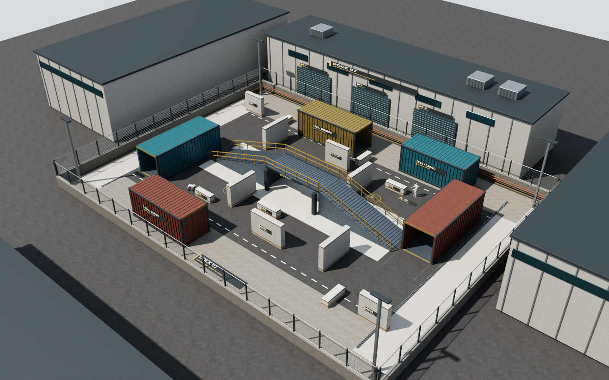

# QuadrupedArena

面向机器人高层规划研究的占点竞技仿真：**LLM 选择意图 → 代码 SKILL 规划和执行 → 裁判更新比赛 → Isaac Sim 生成真实三维场景中的相机图像**。

本仓库整理了截至 2026-10-22 的场景源代码、规则配置、基线策略、非全知视觉决策接口、回放和报告工具。用于让其他研究者在自己的机器上重新生成场景、运行规则、接入规划模型并继续开发，而不只是观看一份视频。

> 当前正式比赛是 Python 裁判 + 有速度/加速度/转向限制的运动学执行，Isaac 负责在线 RGB 和回放渲染。**不是接触动力学中的自主行走，也不是可直接部署到真机的控制系统。** 本仓库不包含训练好的步态策略或真实机器人接口。



上图为 32×24 m 的 DOCK 07 v1 地图审阅结果，不是已接入比赛的大地图。比赛和该地图的成熟度见下表。

## 先选择要复现的内容

| 内容 | 入口 | 是否需要 GPU / API | 状态 |
| --- | --- | --- | --- |
| 裁判规则、路径、基线完整比赛 | `python scripts/cpu_demo.py` | 都不需要 | 推荐从这里开始 |
| 12×8 m 比赛场景、第三视角 GIF/MP4 | `bash run.sh --demo --rotating-targets --industrial --headless` | Isaac GPU；不需要 API | 已用于比赛实验 |
| 机载相机 + 5 个意图技能 | `--vision-trial --semantic-skills --vision-smoke` | Isaac GPU；不需要 API | 2 秒工程预检 |
| 非全知 LLM 闭环比赛 | `--vision-trial --semantic-skills` + 规划器选项 | Isaac GPU；云模型需自备付费 API | 已接入 DeepSeek / Qwen / 外部 JSON 决策 |
| DOCK 07 v1：32×24 m 港区、桥、坡道和集装箱 | `--dockyard --dockyard-config dockyard_v1.json` | Isaac GPU；不需要 API | 地图审阅，尚未接通比赛导航 |
| DOCK 07 v2：港口设施外观和布局迭代 | `--dockyard --dockyard-config dockyard_v2.json` | Isaac GPU；不需要 API | 开发快照，不作为本发布版默认入口 |

**不要把大地图配置直接代入旧比赛。** 旧路径规划和视觉定位仍有 12×8 m、平地假设；桥下/桥上分层导航尚未接通。详见 [场景说明](docs/SCENES.md)。

## 5 分钟开始：先在 CPU 上跑通

以下以 Linux、Python 3.11 为例。已有 Conda 环境也可以；请勿在系统 Python 中混装 Isaac 依赖。

```bash
git clone https://github.com/W1ndYang/QuadrupedArena.git
cd QuadrupedArena
python3.11 -m venv .venv
source .venv/bin/activate
python -m pip install -r requirements-cpu.txt
python scripts/doctor.py
python -m unittest discover -s scripts -p 'test_*.py' -v
python scripts/cpu_demo.py
```

命令不会调用任何模型 API，不会训练，也不需要 Isaac。它运行完整的确定性规则/策略基线，输出终局得分、事件、逐帧轨迹以及文件哈希；终端显示实际输出目录。无贴图环境下，素材集成测试会明确跳过，规则测试不受影响。

默认所有产物保存在仓库内的 **`.arena-workspace/`（已忽略，不上传 Git）**。若遵循“源码 / 仿真素材 / 实验结果分开”的目录规划：

```bash
export ARENA_WORKSPACE=/absolute/path/to/arena-workspace
```

它可指向任意可写目录，不依赖本机用户名、不要求仓库处于特定层级。此变量与 Python 环境、素材和输出的关系见 [安装说明](docs/INSTALL.md)。

## Isaac 场景与演示

先完成 [GPU / Isaac 安装和素材准备](docs/INSTALL.md)。参考组合为 Ubuntu 22.04、Python 3.11、Isaac Sim 5.1.0、Isaac Lab v2.3.2。不是“安装最新版本即可”的项目。

```bash
# 仅在你已经阅读并接受 NVIDIA 许可条款之后设置：
export OMNI_KIT_ACCEPT_EULA=YES
python scripts/prepare_assets.py
python scripts/doctor.py --isaac

# 少量关键帧，先验证场景能否打开；不会调用模型。
bash run.sh --demo --rotating-targets --industrial --headless --preview

# 完整规则基线 + 第三视角 GIF/MP4。
bash run.sh --demo --rotating-targets --industrial --headless

# 扩展大地图的静帧审阅；不是比赛。
bash run.sh --dockyard --dockyard-config dockyard_v1.json --headless --preview --no-tour

# 在线机载 RGB 与技能执行的 2 秒预检；不是 LLM 得分测试。
bash run.sh --vision-trial --semantic-skills --vision-smoke --headless
```

启动后会打印 `Run:`、`Log:`。生成的 USD、贴图和机器人转换缓存放在 `.arena-workspace/simulators/`；逐次日志、JSON、图片和影片放在 `.arena-workspace/experiments/runs/quadruped-arena/<时间戳>/`。不需要把这些大文件提交到源码仓库。

## 当前规则概览

| 项目 | 当前 v0.4 比赛设置 |
| --- | --- |
| 任务 | 人形 B 施压，评价轮足四足 A 的累计占点分；命中本身不加分 |
| 生命和终局 | 双方初始 3 HP，不复活；A 清零或 40 秒结束；B 清零不结束 |
| 占点 | 同时仅一个有效点；P1/P2 循环；A 首次进入后 5 秒失效并刷下一个 |
| 计分 | 连续驻留 1 秒后每秒 1 分；离圈重新驻留，但不重置点的失效期限 |
| 受击 | A 在当前有效圈内受击，该代目标立即失效并刷新；已得分保留 |
| 有效瞄准 | 距离 ≤8 m、机身正前总计 60°、两代表点之间无遮挡 |
| 命中 | 连续瞄准越久，条件命中强度越高；人形增长更快；不是固定 0.8 秒命中 |
| 冷却 | 仅命中方冷却 2 秒；并非双方一起冷却 |
| 地图变化 | 第 20 秒固定墙体一次坍塌，按已知参数替换障碍；不暂停无关瞄准 |
| 决策频率 | 每 2 秒模拟时间一次 LLM 决策，思考时仿真暂停；每 0.5 秒采样 RGB |

完整公式、事件结算顺序、旧 v0.3 与 v0.4 的区别及配置继承见 [比赛规则](docs/RULES.md)。实现和 JSON 是最终依据，旧文档不是当前规则的替代品。

## 接入大模型

使用五个意图技能：`MOVE_TO`、`TAKE_COVER`、`AIM_AT_TRACK`、`CAPTURE_POINT`、`OBSERVE`。LLM 不提交 Python 代码或逐点路径。底层处理几何寻路、避障、朝向和局部执行。

非全知模式中，规划器知道地图、规则和对手初始位置；之后只接收公开状态、机载 RGB、合法视觉记忆，不接收对手当前坐标/朝向/生命值或策略内部状态。首步 1 张图，之后通常为前一边界图 + 4 张新图。

```bash
# 在自己的终端交互输入；密钥隐藏，保存到 Git 目录外的 0600 文件。
bash deepseek.sh setup
bash deepseek.sh prepare                 # 离线检查，不收费
# 明确付费操作：
bash deepseek.sh run

# 百炼官方北京渠道：
bash qwen.sh setup
# 明确付费操作；下列才是非全知视觉版本：
bash run.sh --vision-trial --semantic-skills --qwen-vision min --headless
bash run.sh --vision-trial --semantic-skills --qwen-vision max --headless
```

API 别名、能力、额度可能变化；配置是实验快照，不保证供应商始终提供同一模型。默认 DeepSeek 为 `low` 且输出简明依据；另附最高强度/平台输出上限配置，运行前务必了解其潜在时间和费用。`qwen.sh run` 是**较早的全知 CPU 版本**，不要与 `--qwen-vision` 混同。

具体协议、JSON 样例、外部规划器接入、提示词组成、耗时/Token 口径见 [LLM 与 SKILL 接口](docs/LLM_PROTOCOL.md)。不要求或保存完整内部思维链；`assessment` 是可核验的决策摘要。

## 重新渲染已有比赛

```bash
bash run.sh --demo --industrial --headless --replay-dir /absolute/path/to/completed-run
```

回放需要 `trial_config.json`、`timeline.json`、`events.json`、`validation.json`；CPU 演示也会生成这一组文件。重新渲染**不重新询问模型、不重跑策略、不更改成绩**。它可以更换同几何场景的材质、灯光和视角，不能把旧轨迹直接套进障碍不同的新大地图。

## 仓库导览

```text
QuadrupedArena/
├── configs/                  # 规则继承链、场景、API 参数（不含密钥）
├── scripts/                  # 裁判、基线、技能、Isaac 场景、回放、报告、测试
├── assets/pbr_manifest.json  # 12 张贴图的来源、大小和 SHA-256
├── patches/                  # 固定版本依赖的兼容性补丁
├── docs/
│   ├── INSTALL.md            # 安装、目录规划、素材、依赖版本、排错
│   ├── RULES.md              # 当前规则及边界条件
│   ├── SCENES.md             # 场景版本、视觉/物理边界、大地图接续工作
│   ├── LLM_PROTOCOL.md       # 观察、技能、JSON、模型调用和度量
│   ├── REPRODUCIBILITY.md    # 验证结果、复现层次、研究限制
│   └── history/              # 原机开发记录；只供考古，不作为新机命令
├── requirements-cpu.txt
├── constraints-isaac.txt
├── run.sh / deepseek.sh / qwen.sh
└── .arena-workspace/         # 自动生成；Git 忽略
```

## 已知边界与接续开发

- 非全知的脚点定位需要模型在 RGB 中明确标注可见接地像素；不是成熟目标检测器。记忆到期后的低风险代价不代表“真实环境安全”。
- 当前紧急撤掩体处理并未统一覆盖所有技能。`OBSERVE` 停留过久等失败模式仍可能出现，应作为后续实验对象，而非在基准中悄悄更改。
- 单次固定种子分数不能证明模型普遍优劣。建议同规则、多种子、统一观测与技能，多次重复并报告成功率、得分、延迟及成本。
- 完整历史实验数据、数百 MB 的对比 HTML 离线包和视频没有纳入源码 Git。报告生成器保留，但重建历史多模型报告需要另取原始实验数据；新用户可以先生成自己的结果。
- 旧的 `--robot go2` 物理探针依赖原工程额外修改的 Unitree RL Lab 配置，不属于本仓库的独立复现主线。当前比赛渲染只需要 Unitree ROS 模型，不需要 ROS/Gazebo/训练框架。

请先阅读 [CONTRIBUTING.md](CONTRIBUTING.md) 再修改规则或新增基线；不要覆盖已完成实验的记录。

## 许可证

本项目原创代码与文档采用 [MIT](LICENSE)。Isaac Sim、Isaac Lab、Unitree 模型和 ambientCG 素材遵循各自条款，见 [THIRD_PARTY_NOTICES.md](THIRD_PARTY_NOTICES.md)。本仓库不分发 NVIDIA 软件、API 密钥或机器人模型权重。
