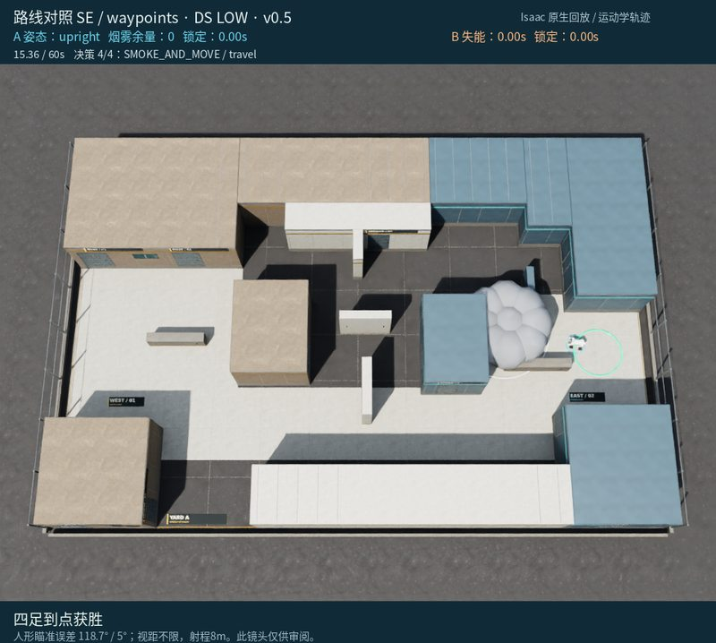

# 对局 1：路点组：北侧绕行、重新观察后投烟到点

[返回成果目录](../README.md) · [完整 MP4](replay.mp4) · [离线交互页面](../index.html#run-1)

15.36秒到点，4次决策。3.46秒已选择经中央北侧和中央东侧绕行，9.64秒接触后撤回，随后短探更新敌情，12.80秒用烟覆盖东侧入口并继续冲点。双方碰撞停步均为0。

> 下文简要依据是模型最终输出的原文，不是完整内部思维链。图片是事后全场审阅镜头，模型当时只收到合法几何观测。

**事后核对：**12.80秒的航向说明把原始弧度数近似当成度，实际归一化朝向约352°；获胜不代表其所有事实解释正确。

[原始决策与合法观测](decisions.json) · [原始返回、时长/token](call_records.json) · [完整系统提示词](system_prompt.txt) · [实际配置](trial_config.json)

## 决策 1 · 仿真 0.00–3.46 s

API 外部耗时 10.25 s；6,095 tokens（含推理）。


**观测依据：** 初始位于SPAWN，当前无合法检测，仅有对手初始位置记忆；目标位于东侧[10.1,-0.8]。

**自身状态：** PK000接近路程3.89m、预测暴露约0.44s，低位墙线可先确认东向威胁；自身满烟、冷却0。

**选择与简要理由：** 先执行一次低成本掩体探身，确认人形当前是否仍在东路及运动趋势，再规划绕行或突击路线。

**不确定性：** 对手可能已离开初始位置；探身预测基于静止假设，不保证绝对安全；探身后需重新评估路线。

```json
{
  "observation_id": 0,
  "skill": "PLAN",
  "params": {
    "horizon_seconds": 5,
    "steps": [
      {
        "skill": "PEEK_BURST",
        "params": {
          "candidate_id": "PK000",
          "max_cycles": 1
        },
        "on_contact": "retreat"
      }
    ]
  }
}
```

实际执行：移动 4.49 m，距目标 15.90 → 15.07 m。完整事件见 [steps.json](steps.json)。

## 决策 2 · 仿真 3.46–9.80 s

API 外部耗时 49.40 s；12,683 tokens（含推理）。


**观测依据：** obs_id=1，t=3.46，PK000探身完成但有效样本0；当前无detection、无last_legal_memory，peek_candidates为空。

**自身状态：** 自位[-4.47,-4.65]直立静止，剩56.54s；绿目标[10.1,-0.8]半径1m；烟剩余1。

**选择与简要理由：** 先经CENTRAL_NORTH、CENTRAL_EAST绕北侧接近EAST_COURT_WEST，途中遇8m内合法人形即撤回；到达后用烟覆盖公开目标中心并进入GOAL。

**不确定性：** 人形当前位置未知，初始[6.2,-2.7]仅为旧信息；中央/东侧仍可能暴露，投烟可行性与途中遮挡需实际执行确认。

```json
{
  "observation_id": 1,
  "skill": "PLAN",
  "params": {
    "horizon_seconds": 8,
    "steps": [
      {
        "skill": "FOLLOW_ROUTE",
        "params": {
          "waypoints": [
            "CENTRAL_NORTH",
            "CENTRAL_EAST",
            "EAST_COURT_WEST"
          ],
          "posture": "upright",
          "fire": "off"
        },
        "on_contact": "retreat"
      },
      {
        "skill": "SMOKE_AND_MOVE",
        "params": {
          "location": [
            10.1,
            -0.8
          ],
          "target": "GOAL",
          "posture": "upright"
        },
        "on_contact": "continue"
      }
    ]
  }
}
```

实际执行：移动 14.47 m，距目标 15.07 → 5.82 m。完整事件见 [steps.json](steps.json)。

## 决策 3 · 仿真 9.80–12.80 s

API 外部耗时 22.88 s；9,237 tokens（含推理）。


**观测依据：** 自机静止于[4.8,1.6]；最近合法记忆人形[6.096,-2.57]，9.66秒更新，当前无检测；PK006接近暴露0，预测探身暴露0.44秒。

**自身状态：** 剩余50.2秒，烟1枚，标记冷却0；到目标约5.8米，仍需先确认人形动态。

**选择与简要理由：** 先利用EastStore北侧PK006进行低成本单次探身，确认人形当前位置与运动趋势；完成后重新规划进圈或烟突进路线。

**不确定性：** 人形可能已离开最后位置或正监视该区域；探身预测假设其暂时静止，不构成绝对安全保证。

```json
{
  "observation_id": 2,
  "skill": "PLAN",
  "params": {
    "horizon_seconds": 5,
    "steps": [
      {
        "skill": "PEEK_BURST",
        "params": {
          "candidate_id": "PK006",
          "max_cycles": 1
        },
        "on_contact": "retreat"
      }
    ]
  }
}
```

实际执行：移动 0.74 m，距目标 5.82 → 5.81 m。完整事件见 [steps.json](steps.json)。

## 决策 4 · 仿真 12.80–15.36 s

API 外部耗时 27.60 s；10,628 tokens（含推理）。


**观测依据：** 12.08-12.38s合法样本显示人形在[5.60,-1.50]附近，yaw约31°，向北移动；当前无合法检测，仍处EastStore北侧遮挡，目标距6.03m。

**自身状态：** 自身在[4.75,1.47]停稳，冷却0，烟剩余1；剩余47.2s，烟建议含[6.1,0.1]且目标可投掷性被列出。

**选择与简要理由：** 向[6.1,0.1]投烟以覆盖/阻断最后已知人形区域，随后直立快速冲GOAL；途中合法见敌也不中止，优先进圈。

**不确定性：** 人形真实位置与朝向未知，烟可能未完全遮住；若投掷被拒会保留烟并继续冲目标，存在暴露风险。

```json
{
  "observation_id": 3,
  "skill": "PLAN",
  "params": {
    "horizon_seconds": 5,
    "steps": [
      {
        "skill": "SMOKE_AND_MOVE",
        "params": {
          "location": [
            6.1,
            0.1
          ],
          "target": "GOAL",
          "posture": "upright"
        },
        "on_contact": "continue"
      }
    ]
  }
}
```

实际执行：移动 5.00 m，距目标 5.81 → 0.98 m。完整事件见 [steps.json](steps.json)。

## 终局



这份记录保留模型原始判断及其错误；赛后分析没有改写已执行动作。
