# 对局 2：候选组：选择了北侧绕行和续接，仍被反复撤退打断

[返回成果目录](../README.md) · [完整 MP4](replay.mp4) · [离线交互页面](../index.html#run-2)

22.84秒被标记，8次决策。12.16秒选17.50米的北侧路线，17.56秒接触后中断；17.62秒重新选北侧，18.12秒选择续接，但两次又被接触守卫打断。19.36秒改为探身，21.62秒新观测使返回掩体失效，最终撤离未及时成功。

> 下文简要依据是模型最终输出的原文，不是完整内部思维链。图片是事后全场审阅镜头，模型当时只收到合法几何观测。

**事后核对：**全局路线选择没有解决8米接触条件过于保守、撤退期间风险和动态掩体失效；17.62秒还错误声称烟1枚，实际已耗尽。

[原始决策与合法观测](decisions.json) · [原始返回、时长/token](call_records.json) · [完整系统提示词](system_prompt.txt) · [实际配置](trial_config.json)

## 决策 1 · 仿真 0.00–3.46 s

API 外部耗时 8.61 s；7,177 tokens（含推理）。

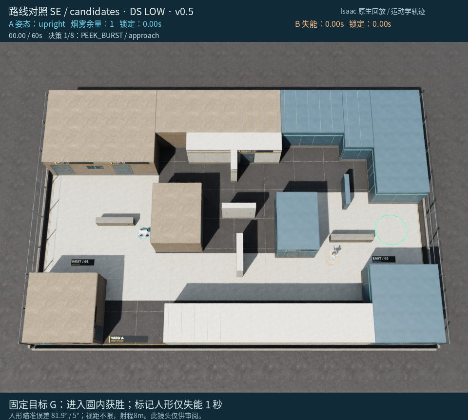

**观测依据：** 初始回合无当前检测、无合法旧敌情；仅已知人形初始位置(6.2,-2.7)。PK000接近段预测暴露0m，探身预测暴露约0.44s。

**自身状态：** 四足位于SPAWN(-5.8,-1.0)，直立速度可用；烟剩余1，冷却0；未执行过路线。

**选择与简要理由：** 先低成本接近LoadingHall西侧掩体并做一次短探，获取东侧/人形当前信息后返回掩体重评；不立即走18m直达路线。

**不确定性：** 人形可能已离开初始位置；候选暴露预测基于静止旧位，不保证安全；本次探身可能触发接敌撤回，尚未使用烟。

```json
{
  "observation_id": 0,
  "skill": "PLAN",
  "params": {
    "horizon_seconds": 5,
    "steps": [
      {
        "skill": "PEEK_BURST",
        "params": {
          "candidate_id": "PK000",
          "max_cycles": 1
        },
        "on_contact": "retreat"
      }
    ]
  }
}
```

实际执行：移动 4.49 m，距目标 15.90 → 15.07 m。完整事件见 [steps.json](steps.json)。

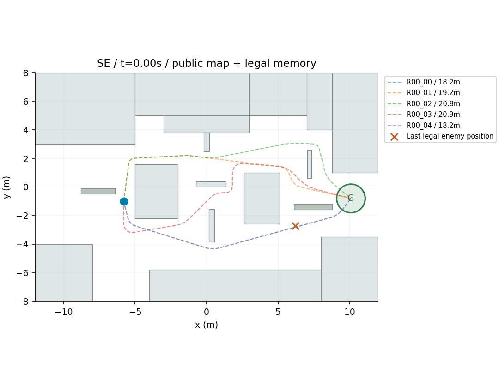

路线卡只使用合法敌情和静态风险估计；加粗为选中路线。模型未收到此图。

## 决策 2 · 仿真 3.46–7.40 s

API 外部耗时 28.75 s；9,622 tokens（含推理）。


**观测依据：** 本次PEEK_BURST完成返回掩体，采样点均无合法探测到人形；最近合法记忆中也没有人形位置，当前无可见目标。

**自身状态：** 自身在[-4.47,-4.65]，直立静止，烟剩余1，剩余约56.5s；无激活路线，路线候选均基于未知/旧敌情。

**选择与简要理由：** 选择R01_02经CENTRAL_SOUTH与EAST_COURT_WEST向GOAL推进，避开已知初始敌位[6.2,-2.7]南侧近路；直立快速通过，fire=off优先完成进圈，遇合法8m内人形则撤回重评。

**不确定性：** 人形当前真实位置与朝向未知，路线风险仅按静止旧位置估计；东侧走廊可能遭遇人形，必要时下次用烟或换路。

```json
{
  "observation_id": 1,
  "skill": "PLAN",
  "params": {
    "horizon_seconds": 8,
    "steps": [
      {
        "skill": "FOLLOW_CANDIDATE",
        "params": {
          "route_id": "R01_02",
          "posture": "upright",
          "fire": "off"
        },
        "on_contact": "retreat"
      }
    ]
  }
}
```

实际执行：移动 9.75 m，距目标 15.07 → 6.00 m。完整事件见 [steps.json](steps.json)。

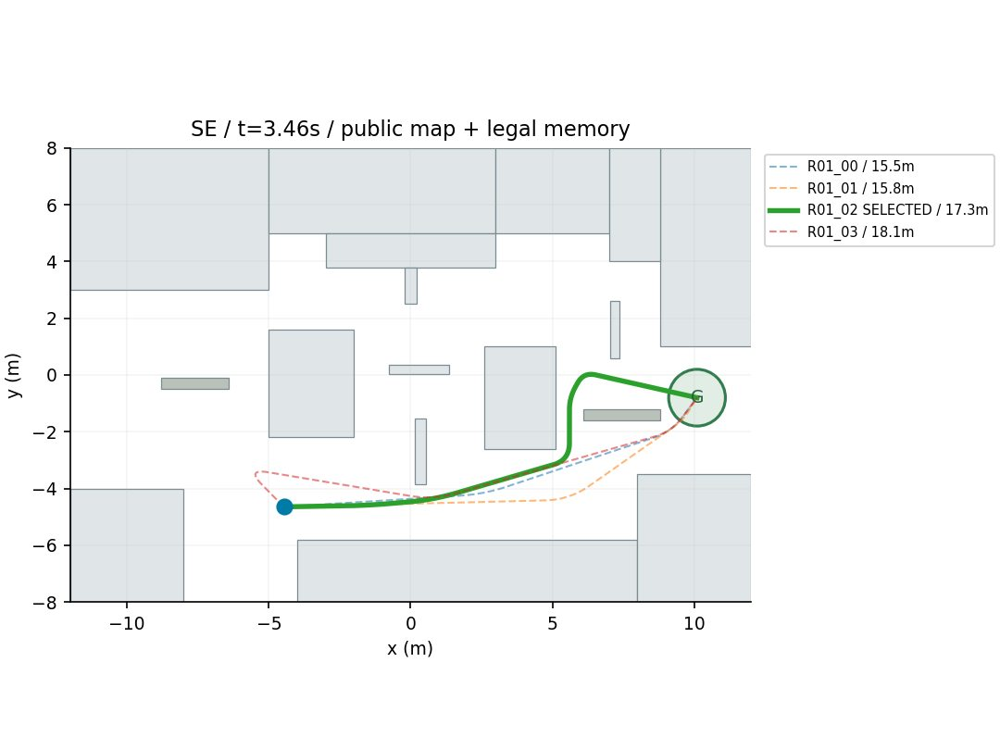

路线卡只使用合法敌情和静态风险估计；加粗为选中路线。模型未收到此图。

## 决策 3 · 仿真 7.40–9.54 s

API 外部耗时 25.10 s；11,198 tokens（含推理）。


**观测依据：** 当前无检测；最近合法记忆人形在[5.6,-1.4]，年龄0.12s；我在[4.6,-3.2]掩体后，距GOAL约6.2m。

**自身状态：** 速度0，直立，烟1，标记冷却0，剩余52.6s；R02_04长6.21m，烟落点[7,-2.6]，约0.78s生效并持续5s。

**选择与简要理由：** 选R02_04先投烟再直达GOAL，直立全速且不主动开火；若途中8m内合法看见人形则撤回。烟可遮断人形近位视线。

**不确定性：** 人形可能移动或绕出烟边缘，静止敌位估计不保证安全；若接触中止则回掩体重评。

```json
{
  "observation_id": 2,
  "skill": "PLAN",
  "params": {
    "horizon_seconds": 5,
    "steps": [
      {
        "skill": "FOLLOW_CANDIDATE",
        "params": {
          "route_id": "R02_04",
          "posture": "upright",
          "fire": "off"
        },
        "on_contact": "retreat"
      }
    ]
  }
}
```

实际执行：移动 0.41 m，距目标 6.00 → 6.18 m。完整事件见 [steps.json](steps.json)。

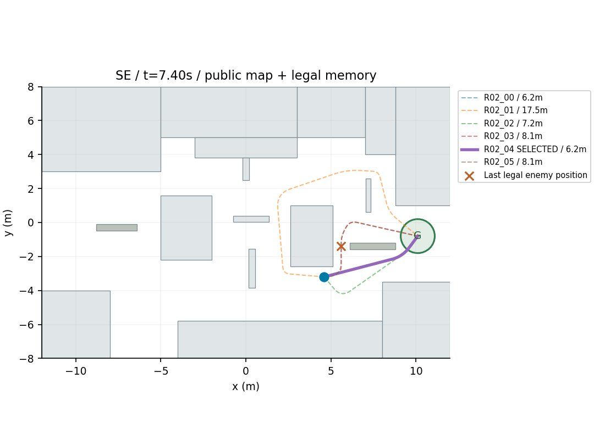

路线卡只使用合法敌情和静态风险估计；加粗为选中路线。模型未收到此图。

## 决策 4 · 仿真 9.54–12.16 s

API 外部耗时 13.56 s；9,414 tokens（含推理）。

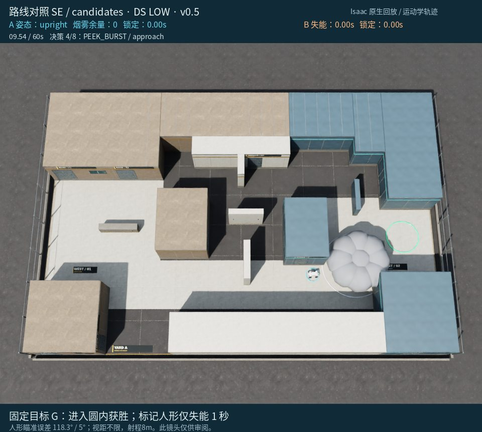

**观测依据：** 当前无合法检测；最近合法记忆敌位(5.72,-1.89)在8.16s，年龄1.38s，估计向东南移动；目标在(10.1,-0.8)。

**自身状态：** 本体在(4.40,-3.20)东店南侧掩体，直立，速度0.10，冷却0；剩余50.46s；无当前烟。

**选择与简要理由：** 先用PK012低成本探身确认近距离敌情；其接近暴露0m、预计暴露0.4s，完成后回掩体再选路线。

**不确定性：** 旧敌位非当前真值，敌方可能已绕至路线侧翼；探身预测基于静止旧位，不保证安全。

```json
{
  "observation_id": 3,
  "skill": "PLAN",
  "params": {
    "horizon_seconds": 4,
    "steps": [
      {
        "skill": "PEEK_BURST",
        "params": {
          "candidate_id": "PK012",
          "max_cycles": 1
        },
        "on_contact": "retreat"
      }
    ]
  }
}
```

实际执行：移动 0.74 m，距目标 6.18 → 6.09 m。完整事件见 [steps.json](steps.json)。

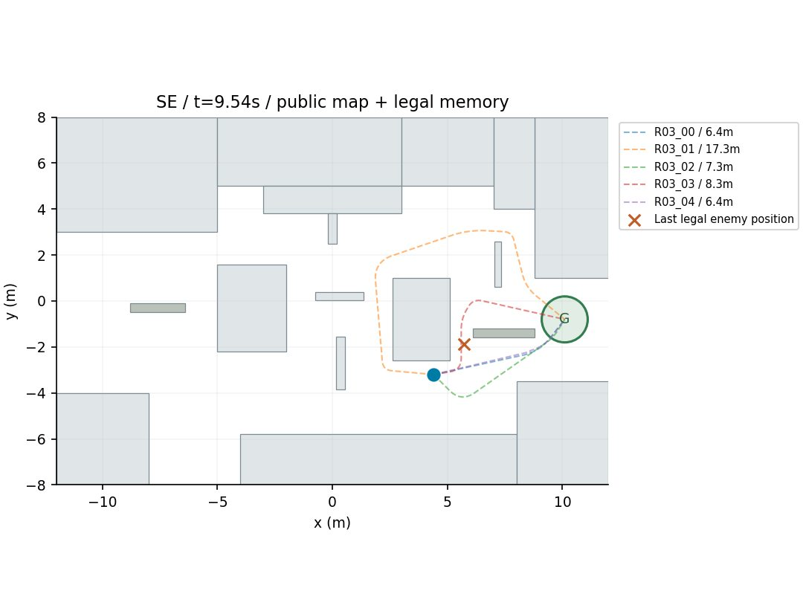

路线卡只使用合法敌情和静态风险估计；加粗为选中路线。模型未收到此图。

## 决策 5 · 仿真 12.16–17.62 s

API 外部耗时 58.31 s；16,433 tokens（含推理）。

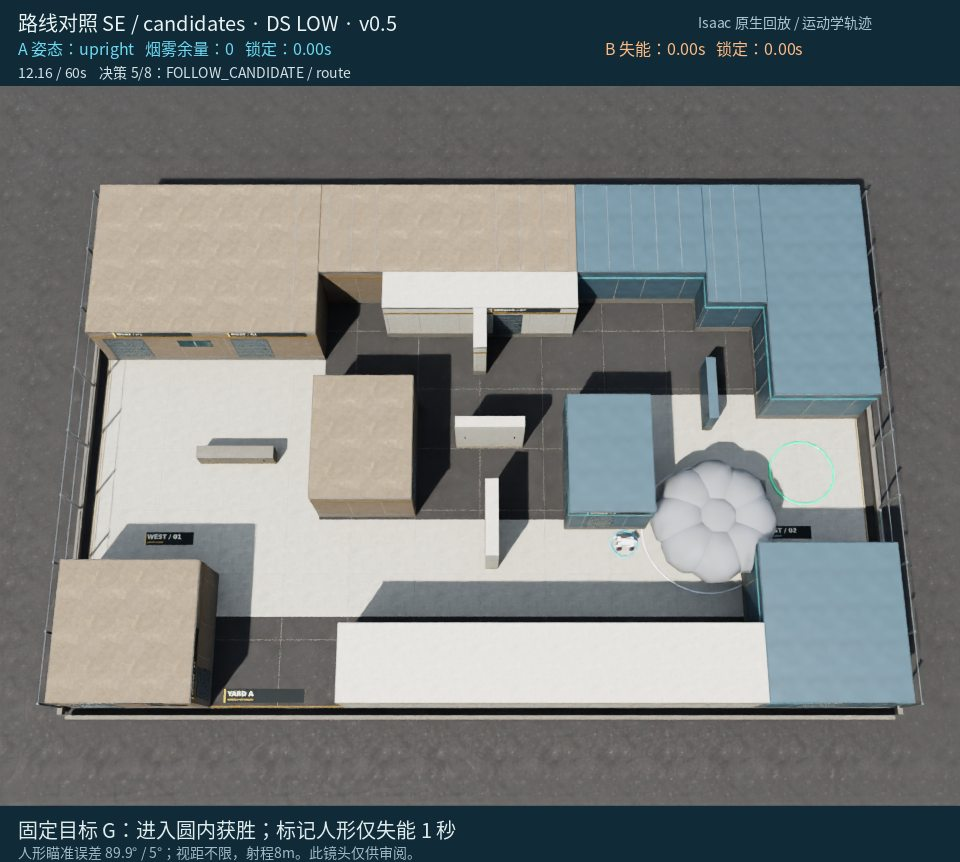

**观测依据：** 当前无合法检测；最近合法记忆为4.0s前[5.72,-1.89]，最近两次PEEK均无样本，敌当前真值未知。

**自身状态：** 自身在[4.45,-3.07]直立静止，烟余量0，剩余47.84s，目标[10.1,-0.8]。

**选择与简要理由：** 选R04_01北侧绕行：直达R04_00最近敌距1.04m且最长连续暴露1.7s；R04_01最长暴露1.0s、3个掩体检查点、最近1.73m，时间可负担。

**不确定性：** 敌情年龄4s且可能移动；候选风险按静止敌位估计，非安全保证；遇8m内合法看到人形即撤回。

```json
{
  "observation_id": 4,
  "skill": "PLAN",
  "params": {
    "horizon_seconds": 8,
    "steps": [
      {
        "skill": "FOLLOW_CANDIDATE",
        "params": {
          "route_id": "R04_01",
          "posture": "upright",
          "fire": "off"
        },
        "on_contact": "retreat"
      }
    ]
  }
}
```

实际执行：移动 10.02 m，距目标 6.09 → 6.57 m。完整事件见 [steps.json](steps.json)。

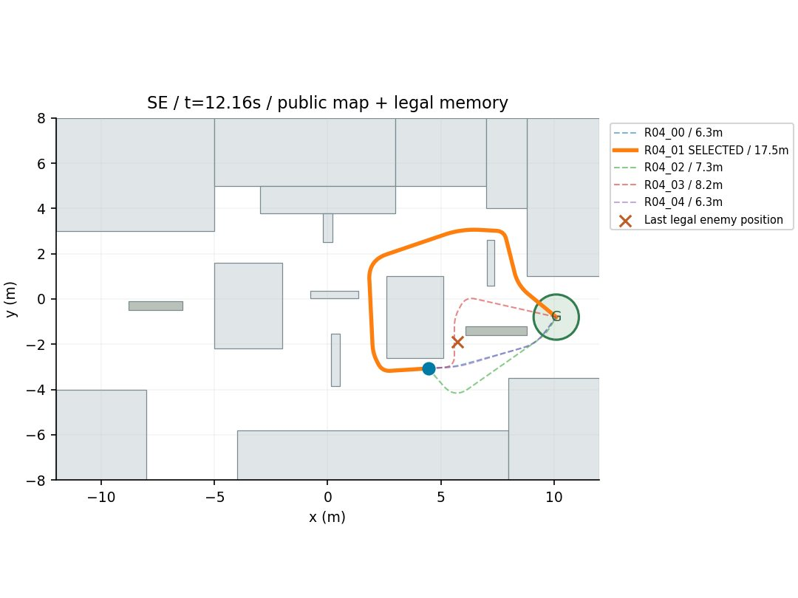

路线卡只使用合法敌情和静态风险估计；加粗为选中路线。模型未收到此图。

## 决策 6 · 仿真 17.62–18.12 s

API 外部耗时 11.50 s；9,358 tokens（含推理）。


**观测依据：** 17.56秒合法看到人形于(5.61,-1.45)，记忆年龄0.06秒；当前无新检测；自车在已知掩体。

**自身状态：** 自车位置(4.6,2.8)，直立，速度0，冷却0，烟1；剩余42.38秒；R05_01完整可通行。

**选择与简要理由：** 选择经NORTH_WINDOW的R05_01，直立快速推进且不开火；遇8m内合法可见人形则中止撤回。该路线最长静态暴露1.36秒、最近敌距3.55米，优于直达与更长绕行。

**不确定性：** 人形可能已离开最后位置或转向拦截；静态暴露估计不保证安全，路线末端仍需重新确认。

```json
{
  "observation_id": 5,
  "skill": "PLAN",
  "params": {
    "horizon_seconds": 5,
    "steps": [
      {
        "skill": "FOLLOW_CANDIDATE",
        "params": {
          "route_id": "R05_01",
          "posture": "upright",
          "fire": "off"
        },
        "on_contact": "retreat"
      }
    ]
  }
}
```

实际执行：移动 0.24 m，距目标 6.57 → 6.56 m。完整事件见 [steps.json](steps.json)。

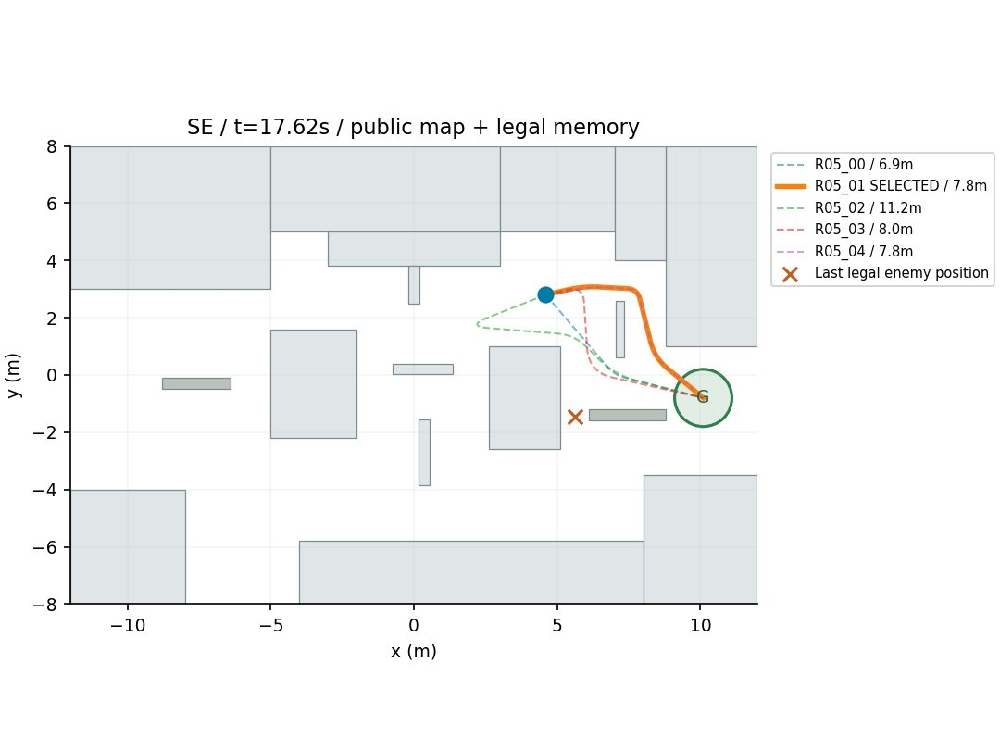

路线卡只使用合法敌情和静态风险估计；加粗为选中路线。模型未收到此图。

## 决策 7 · 仿真 18.12–19.36 s

API 外部耗时 14.24 s；9,363 tokens（含推理）。


**观测依据：** 最近合法观测于17.84s看到人形在[5.66,-1.63]、朝向约44.4°；当前无实时检测，观测年龄0.28s。

**自身状态：** 四足在[4.62,2.81]速度0，目标[10.1,-0.8]，剩余41.88s。R06_04经NORTH_WINDOW，长7.75m，预计3.6s，最长静态暴露1.4s，静态最近敌距3.62m。

**选择与简要理由：** 选择续接R06_04绕北窗口推进，直立且fire off；遇8m内合法人形即中止撤回。避免直达路线较短但暴露2.66s、静态最近敌距仅2.16m。

**不确定性：** 最后敌位不是当前真值，对方可能移动后设伏；暴露和距离仅基于静止旧位置估计，不构成安全保证。

```json
{
  "observation_id": 6,
  "skill": "PLAN",
  "params": {
    "horizon_seconds": 5,
    "steps": [
      {
        "skill": "FOLLOW_CANDIDATE",
        "params": {
          "route_id": "R06_04",
          "posture": "upright",
          "fire": "off"
        },
        "on_contact": "retreat"
      }
    ]
  }
}
```

实际执行：移动 0.29 m，距目标 6.56 → 6.68 m。完整事件见 [steps.json](steps.json)。

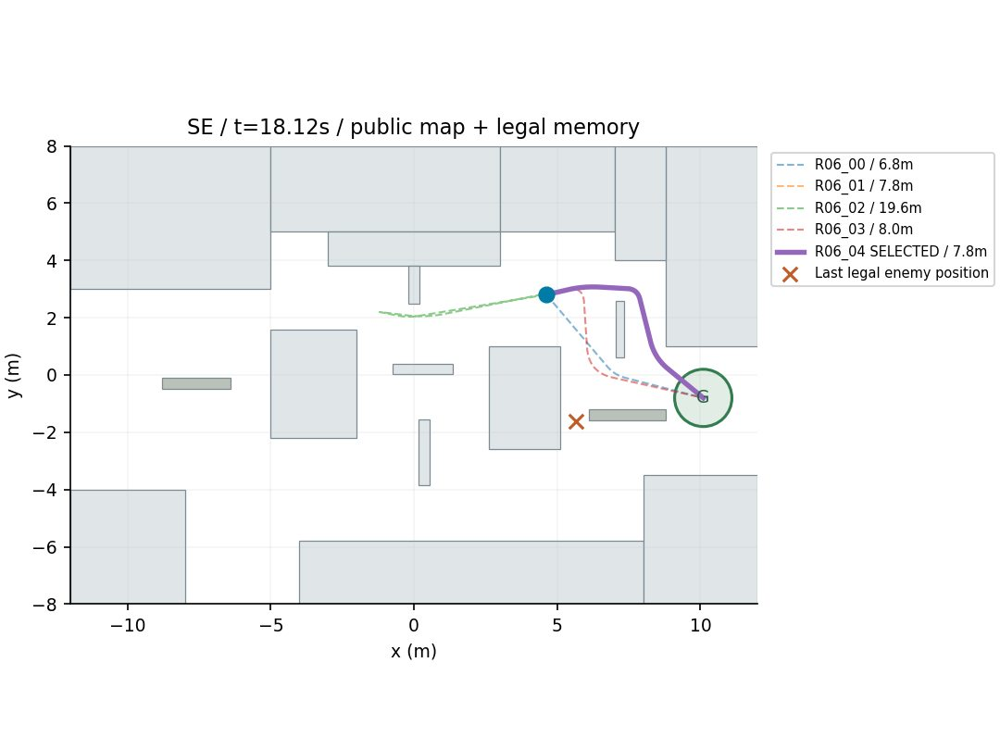

路线卡只使用合法敌情和静态风险估计；加粗为选中路线。模型未收到此图。

## 决策 8 · 仿真 19.36–22.84 s

API 外部耗时 44.81 s；13,707 tokens（含推理）。


**观测依据：** 当前无检测；最后合法敌位约[5.72,-1.87]，年龄0.98s，朝向约45.8°。PK037接近段预测暴露0m、爆出暴露0.5s。

**自身状态：** 自位约[4.60,3.00]，执行反馈ROUTE_ACTIVE，仍在已知掩体；冷却0，烟余量0，剩余40.64s。

**选择与简要理由：** 先用PK037做一次低暴露短探，更新人形位置与朝向后回掩体重评；避免在旧敌情下继续沿此前多次触发contact_guard的路线盲目推进。

**不确定性：** 预测基于静止旧敌位，不保证人形未移动或转向；短探可能无样本；探身本身仍可能被对手短时观察。

```json
{
  "observation_id": 7,
  "skill": "PLAN",
  "params": {
    "horizon_seconds": 5,
    "steps": [
      {
        "skill": "PEEK_BURST",
        "params": {
          "candidate_id": "PK037",
          "max_cycles": 1
        },
        "on_contact": "retreat"
      }
    ]
  }
}
```

实际执行：移动 2.19 m，距目标 6.68 → 7.99 m。完整事件见 [steps.json](steps.json)。

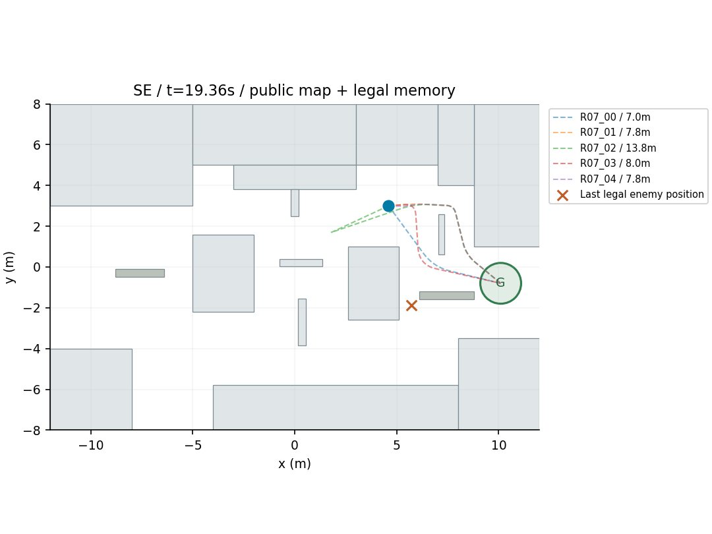

路线卡只使用合法敌情和静态风险估计；加粗为选中路线。模型未收到此图。

## 终局

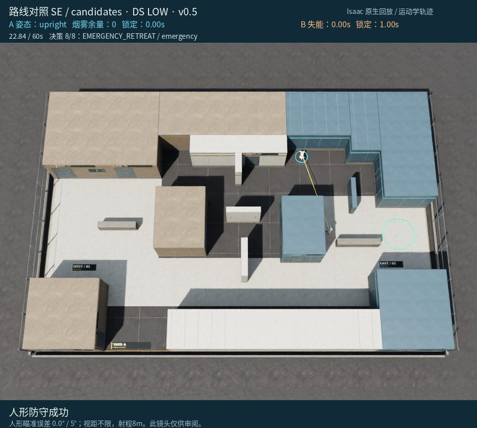

这份记录保留模型原始判断及其错误；赛后分析没有改写已执行动作。
