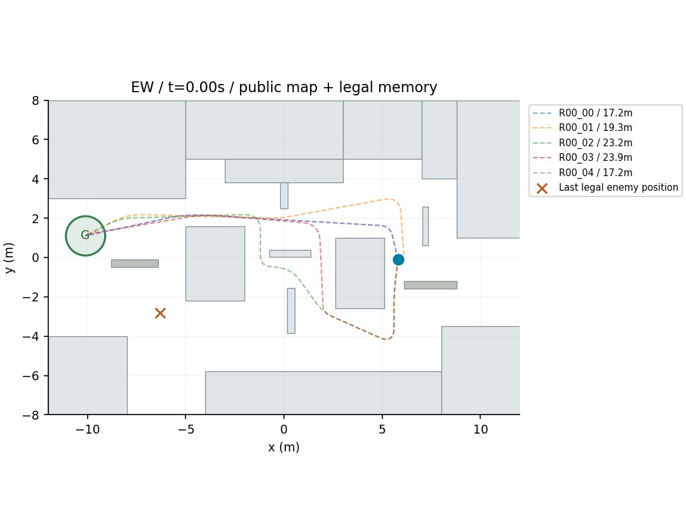
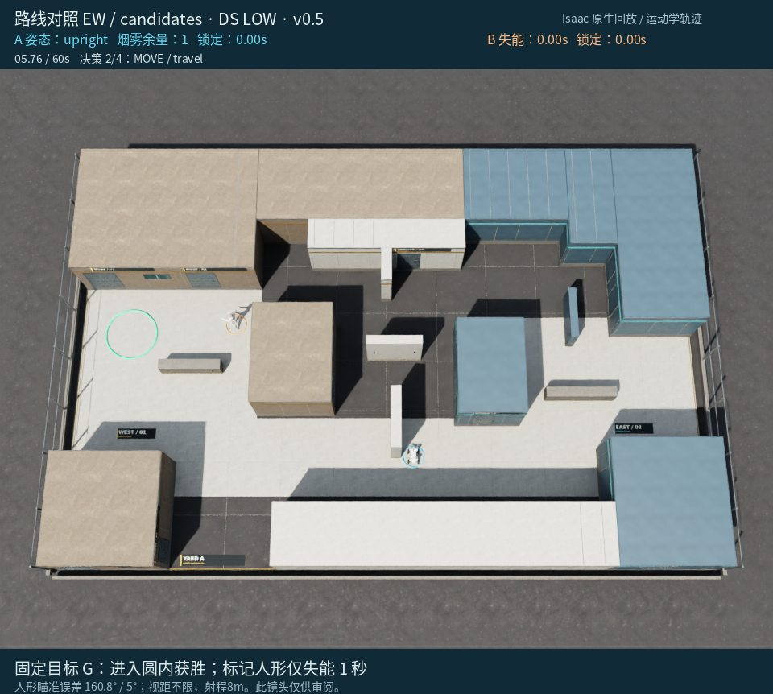
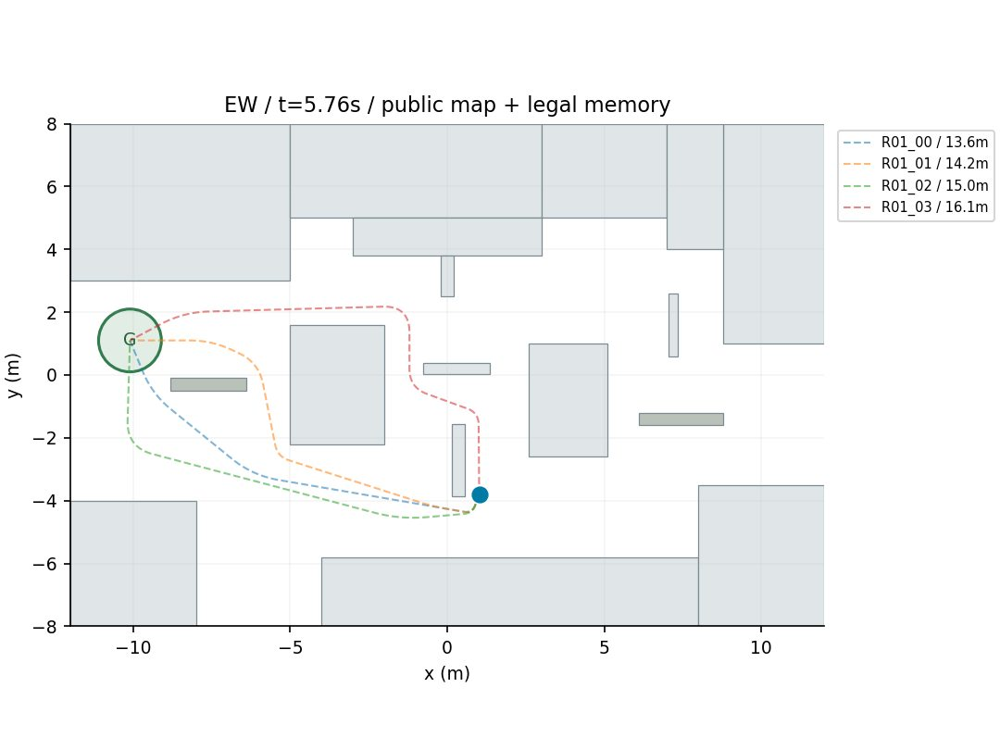
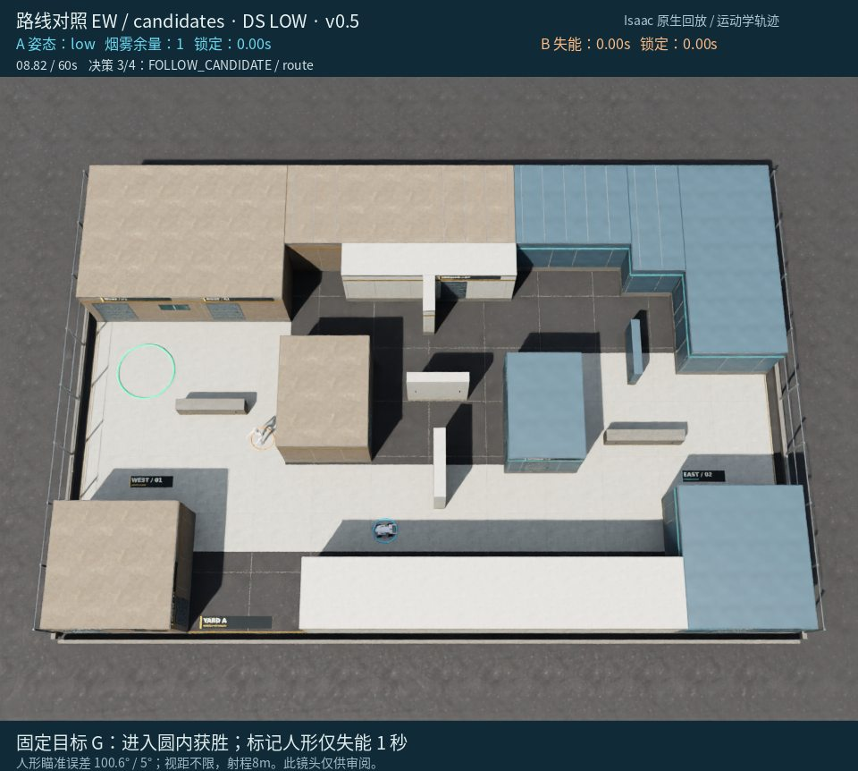
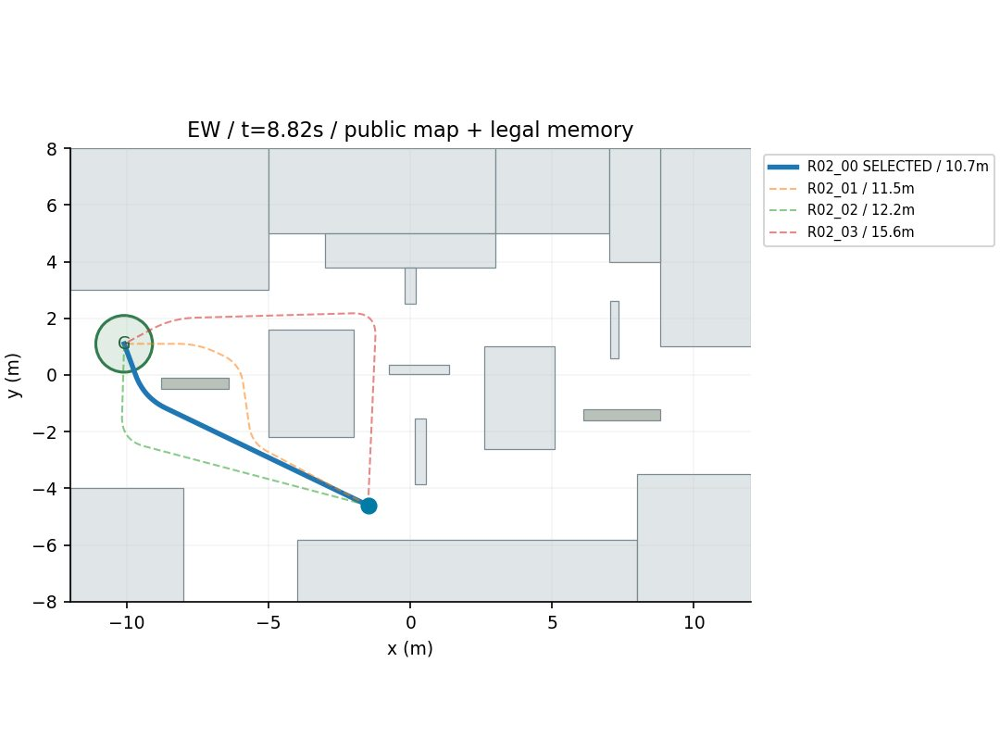
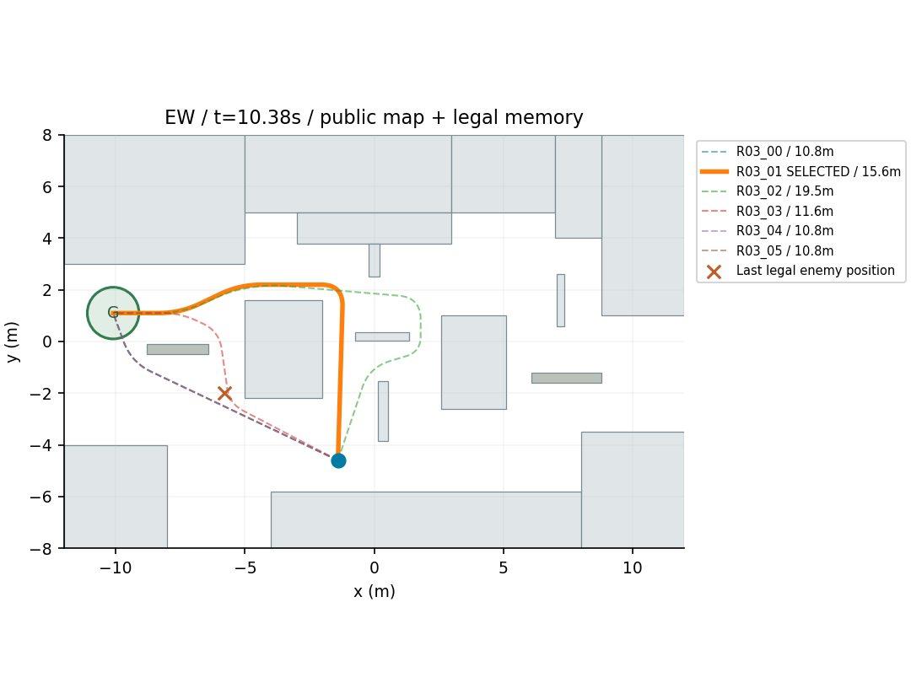
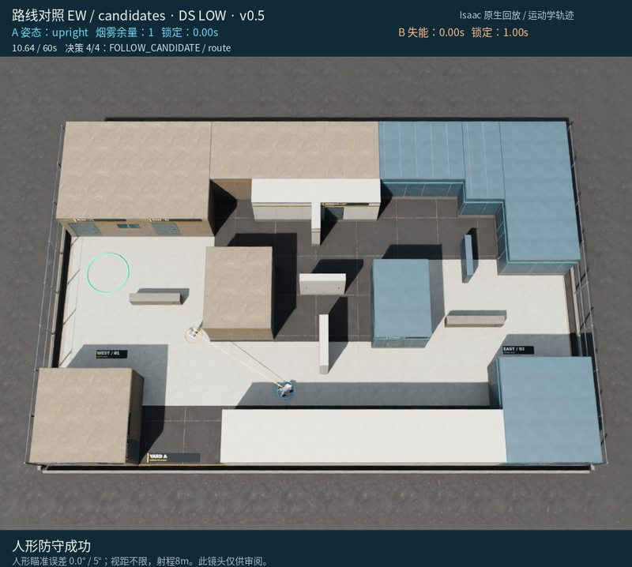

# 对局 3：候选组：迟到的北侧绕行来不及脱离当前瞄准

[返回成果目录](../README.md) · [完整 MP4](replay.mp4) · [离线交互页面](../index.html#run-3)

10.64秒被标记，4次决策。初次探身零样本，转移后仍无敌情；8.82秒选直达。9.08秒接触触发撤退，到10.38秒重新决策时仍被看见；此时改选经中央北侧、WEST_LOW_NORTH的15.57米路线并continue，0.26秒后即被标记。

> 下文简要依据是模型最终输出的原文，不是完整内部思维链。图片是事后全场审阅镜头，模型当时只收到合法几何观测。

**事后核对：**路线卡只提供全程风险，缺少“从当前状态最快多久能断开视线”的应急约束；审阅中的人形瞄准进度没有泄漏给模型。

[原始决策与合法观测](decisions.json) · [原始返回、时长/token](call_records.json) · [完整系统提示词](system_prompt.txt) · [实际配置](trial_config.json)

## 决策 1 · 仿真 0.00–5.76 s

API 外部耗时 14.08 s；8,138 tokens（含推理）。


**观测依据：** 当前无合法检测；仅有初始人形位置[-6.3,-2.8]，且明确不是当前真值。

**自身状态：** 自身位于[5.8,-0.1]，直立，速度0，烟1，冷却0，剩余60秒；PK001接近暴露预测0.0m、探身暴露约0.5s。

**选择与简要理由：** 先前往SouthHighWall东侧PK001掩体做一次低成本探身，获取西/南方向信息后再规划通往GOAL的完整路线，避免依据旧敌位盲走。

**不确定性：** 人形可能已离开初始位置或在探身时移动；暴露预测基于静止旧敌位，不构成安全保证。

```json
{
  "observation_id": 0,
  "skill": "PLAN",
  "params": {
    "horizon_seconds": 6,
    "steps": [
      {
        "skill": "PEEK_BURST",
        "params": {
          "candidate_id": "PK001",
          "max_cycles": 1
        },
        "on_contact": "retreat"
      }
    ]
  }
}
```

实际执行：移动 8.01 m，距目标 15.95 → 12.15 m。完整事件见 [steps.json](steps.json)。



路线卡只使用合法敌情和静态风险估计；加粗为选中路线。模型未收到此图。

## 决策 2 · 仿真 5.76–8.82 s

API 外部耗时 25.15 s；9,037 tokens（含推理）。



**观测依据：** PEEK_BURST完成，0个合法采样；当前无检测，last_legal_memory为空；peek_candidates为空。

**自身状态：** 自身位于[1.02,-3.8]，静止直立，烟剩余1，剩余54.24s；目标在[-10.1,1.1]。

**选择与简要理由：** 无法再探身，先低姿态转移至CENTRAL_SOUTH掩体观察；途中若合法看到8m内人形则撤回，避免被标记。

**不确定性：** 人形当前位置未知，仅有初始先验[-6.3,-2.8]；移动路径暴露风险未知，CENTRAL_SOUTH不保证绝对安全。

```json
{
  "observation_id": 1,
  "skill": "PLAN",
  "params": {
    "horizon_seconds": 4,
    "steps": [
      {
        "skill": "MOVE",
        "params": {
          "target": "CENTRAL_SOUTH",
          "posture": "low",
          "fire": "off"
        },
        "on_contact": "retreat"
      }
    ]
  }
}
```

实际执行：移动 2.89 m，距目标 12.15 → 10.32 m。完整事件见 [steps.json](steps.json)。



路线卡只使用合法敌情和静态风险估计；加粗为选中路线。模型未收到此图。

## 决策 3 · 仿真 8.82–10.38 s

API 外部耗时 50.28 s；13,360 tokens（含推理）。



**观测依据：** 当前无检测，最近合法记忆为空，153个采样均null，无探身候选；旧初始位置不能当当前真值。

**自身状态：** 四足在CENTRAL_SOUTH低姿态，速度0.176，烟1，剩余51.18s，当前无活动路线。

**选择与简要理由：** 选R02_00直达GOAL，直立缩短暴露至约4.1s，fire off优先推进，遇8m内合法人形即retreat。

**不确定性：** 人形当前未知，距初始已8.82s，路线风险未计算；不假设安全，定时或接触后重评。

```json
{
  "observation_id": 2,
  "skill": "PLAN",
  "params": {
    "horizon_seconds": 8,
    "steps": [
      {
        "skill": "FOLLOW_CANDIDATE",
        "params": {
          "route_id": "R02_00",
          "posture": "upright",
          "fire": "off"
        },
        "on_contact": "retreat"
      }
    ]
  }
}
```

实际执行：移动 0.15 m，距目标 10.32 → 10.40 m。完整事件见 [steps.json](steps.json)。



路线卡只使用合法敌情和静态风险估计；加粗为选中路线。模型未收到此图。

## 决策 4 · 仿真 10.38–10.64 s

API 外部耗时 29.55 s；12,012 tokens（含推理）。


**观测依据：** 10.38秒合法看到人形于(-5.80,-1.99)，与本机距约4.7m，其朝向约24.6°；当前已可见，故节点用continue避免立即因contact_guard撤回。

**自身状态：** 本机位于(-1.40,-4.60)，速度0.085m/s，烟1，剩余49.62s；R03_01直立预计6.62s、总暴露1.96s、最近敌距3.55m。

**选择与简要理由：** 选择绕北R03_01直达GOAL，避开最近距离仅0.47m的直接路线；直立执行、不触发机会射击，保留烟雾给后续。

**不确定性：** 暴露与敌距仅按当前人形静止位置估计，不保证其不转向或移动；continue不代表免伤，若受阻或计划超时需重评。

```json
{
  "observation_id": 3,
  "skill": "PLAN",
  "params": {
    "horizon_seconds": 8,
    "steps": [
      {
        "skill": "FOLLOW_CANDIDATE",
        "params": {
          "route_id": "R03_01",
          "posture": "upright",
          "fire": "off"
        },
        "on_contact": "continue"
      }
    ]
  }
}
```

实际执行：移动 0.00 m，距目标 10.40 → 10.40 m。完整事件见 [steps.json](steps.json)。



路线卡只使用合法敌情和静态风险估计；加粗为选中路线。模型未收到此图。

## 终局



这份记录保留模型原始判断及其错误；赛后分析没有改写已执行动作。
