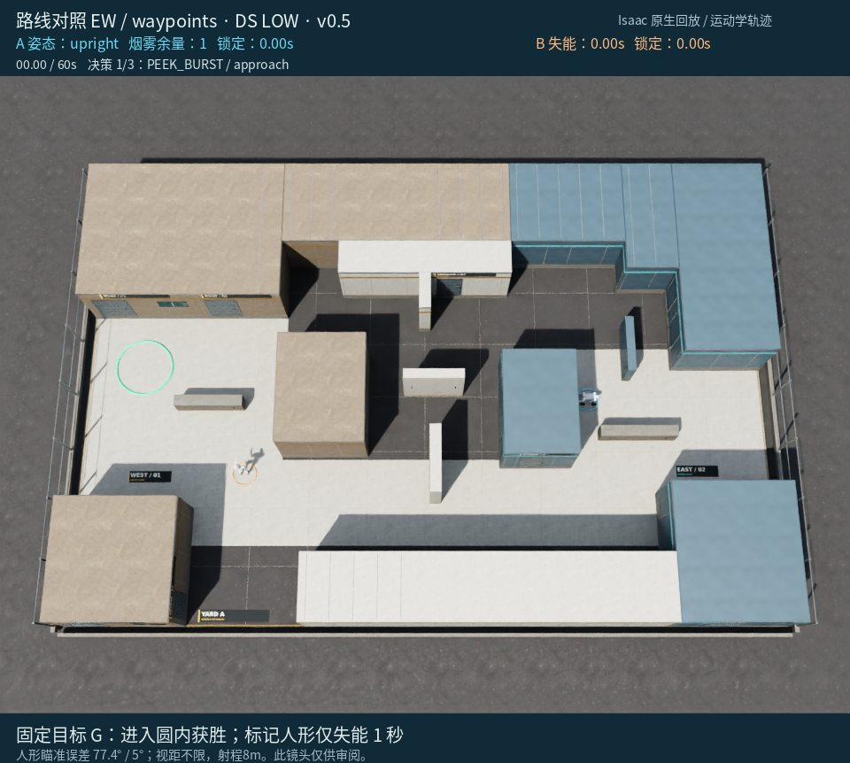
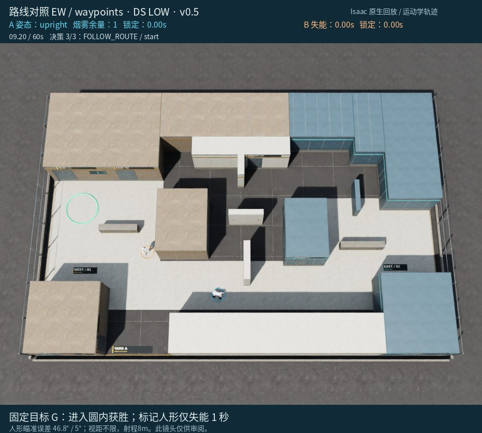

# 对局 4：路点组：把敌方朝向读错后继续近距穿越

[返回成果目录](../README.md) · [完整 MP4](replay.mp4) · [离线交互页面](../index.html#run-4)

10.64秒被标记，3次决策。两次探身没有样本，之后沿南侧接近。9.20秒模型认为所选路线在人形视野之外，但当时可合法检测，实际人形朝向归一化约282.31°；模型写成约23.8°。随后继续通过人形近处，未能阻断锁定。

> 下文简要依据是模型最终输出的原文，不是完整内部思维链。图片是事后全场审阅镜头，模型当时只收到合法几何观测。

**事后核对：**原始yaw仍是未归一化弧度，模型存在单位误读；这属于两组共同的接口缺陷，当前试验不能把所有失败归于规划能力。

[原始决策与合法观测](decisions.json) · [原始返回、时长/token](call_records.json) · [完整系统提示词](system_prompt.txt) · [实际配置](trial_config.json)

## 决策 1 · 仿真 0.00–5.44 s

API 外部耗时 49.84 s；12,150 tokens（含推理）。



**观测依据：** 当前无检测，仅有初始敌位(-6.3,-2.8)与自位(5.8,-0.1)。PK000距已知敌约14m>8m，预测暴露0.48s，适合远距探身。

**自身状态：** 目标中心(-10.1,1.1)，剩余60s，烟1，四足upright且冷却0。地图西侧目标邻近初始敌位，直接接近风险高。

**选择与简要理由：** 先到EastEquipment西侧掩体执行PK000探身，获取人形当前位置与动向；完成后停掩体并重新决策，避免在信息不足时直冲西侧目标。

**不确定性：** 旧敌位不等于当前真值；若人形已移动、墙/烟遮挡或视线无效，探身可能无有效样本。接近或探身中若合法发现8m内人形则立即撤退。

```json
{
  "observation_id": 0,
  "skill": "PLAN",
  "params": {
    "horizon_seconds": 6,
    "steps": [
      {
        "skill": "PEEK_BURST",
        "params": {
          "candidate_id": "PK000",
          "max_cycles": 2
        },
        "on_contact": "retreat"
      }
    ]
  }
}
```

实际执行：移动 6.48 m，距目标 15.95 → 18.61 m。完整事件见 [steps.json](steps.json)。

## 决策 2 · 仿真 5.44–9.20 s

API 外部耗时 10.66 s；6,497 tokens（含推理）。


**观测依据：** 刚完成两次PK000探身，累计有效样本0，当前检测为null，且本次无可用peek_candidates；旧敌位不能作为当前真值。

**自身状态：** 自身在[7.53,-4.85]停稳，剩余54.56s，烟雾剩余1；目标中心[-10.1,1.1]，公开路线到GOAL约19.66m。

**选择与简要理由：** 沿南侧经SOUTH_ENTRY、CENTRAL_SOUTH、WEST_HIDE接近GOAL，直立快速推进并允许机会射击；一旦合法发现8m内人形则中止路线撤回。

**不确定性：** 人形当前位置与巡逻路径未知，可能已向中央或目标附近移动；所选路线仍需经过潜在暴露区，遇敌撤退点不保证绝对安全。

```json
{
  "observation_id": 1,
  "skill": "PLAN",
  "params": {
    "horizon_seconds": 8,
    "steps": [
      {
        "skill": "FOLLOW_ROUTE",
        "params": {
          "waypoints": [
            "SOUTH_ENTRY",
            "CENTRAL_SOUTH",
            "WEST_HIDE",
            "GOAL"
          ],
          "posture": "upright",
          "fire": "opportunistic"
        },
        "on_contact": "retreat"
      }
    ]
  }
}
```

实际执行：移动 9.08 m，距目标 18.61 → 10.29 m。完整事件见 [steps.json](steps.json)。

## 决策 3 · 仿真 9.20–10.64 s

API 外部耗时 52.06 s；14,246 tokens（含推理）。



**观测依据：** 9.2s当前合法检测人形于[-5.81,-1.76]，距自身约5.1m，人形朝向约23.8°；自身停稳于[-1.4,-4.4]。

**自身状态：** 剩余50.8s，目标距10.8m，烟1，冷却0；经WEST_HIDE、WEST_LANE至GOAL约12.4m，直立约4s可达。

**选择与简要理由：** 选择直立全速经WEST_HIDE、WEST_LANE到GOAL，fire=off避免停顿，on_contact=continue；该路线位于人形当前前180°视野边界之外。

**不确定性：** 人形可能转向搜索或移动；WEST_HIDE附近与其最近约1.5m，若其提前大幅转向仍可能暴露；受阻将重新决策。

```json
{
  "observation_id": 2,
  "skill": "PLAN",
  "params": {
    "horizon_seconds": 7,
    "steps": [
      {
        "skill": "FOLLOW_ROUTE",
        "params": {
          "waypoints": [
            "WEST_HIDE",
            "WEST_LANE",
            "GOAL"
          ],
          "posture": "upright",
          "fire": "off"
        },
        "on_contact": "continue"
      }
    ]
  }
}
```

实际执行：移动 3.79 m，距目标 10.29 → 6.80 m。完整事件见 [steps.json](steps.json)。

## 终局


这份记录保留模型原始判断及其错误；赛后分析没有改写已执行动作。
