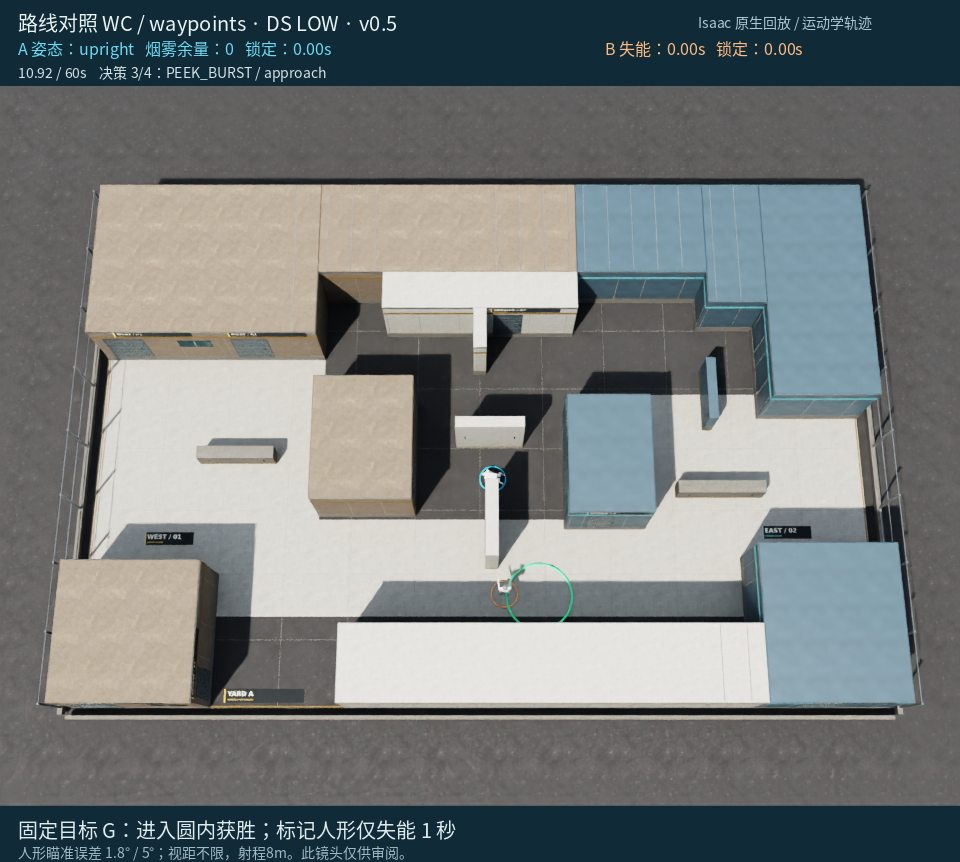
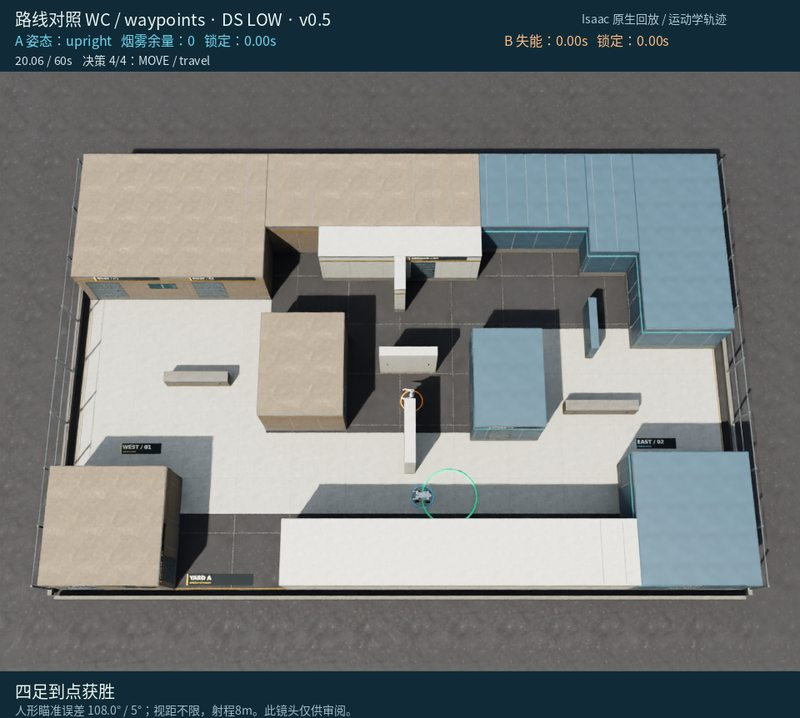

# 对局 5：路点组：烟后动态绕避、补充观察，最后从墙侧到点

[返回成果目录](../README.md) · [完整 MP4](replay.mp4) · [离线交互页面](../index.html#run-5)

20.06秒到点，4次决策。3.68秒根据合法敌情投烟推进，随后原单目标技能的局部路径层随敌情调整；9.68秒计划到时撤向中央掩体。两次短探后，14.80秒通过CENTRAL_SOUTH再到GOAL。双方碰撞停步均为0。

> 下文简要依据是模型最终输出的原文，不是完整内部思维链。图片是事后全场审阅镜头，模型当时只收到合法几何观测。

**事后核对：**最后决策错误声称还有烟并再次请求施放，实际上烟早已用完，只执行移动；不能把最后成功解释为第二颗烟的效果。

[原始决策与合法观测](decisions.json) · [原始返回、时长/token](call_records.json) · [完整系统提示词](system_prompt.txt) · [实际配置](trial_config.json)

## 决策 1 · 仿真 0.00–3.68 s

API 外部耗时 17.32 s；7,210 tokens（含推理）。


**观测依据：** t=0，自身在SPAWN(-9.8,1.5)，无当前检测；仅知人形初始(5.8,-3.2)，目标(1.8,-4.7)。

**自身状态：** 烟1枚，冷却0，直立；PK000从EntryRoom东侧探身，预测暴露0.48s，接近暴露0m（按静态初始敌位估算）。

**选择与简要理由：** 先用PK000执行最多两次短探获取近目标区信息，不盲射；发现8m内人形立即撤回，探身结束后再规划路线。

**不确定性：** 人形可能已离开初始位置，静态预测不保证安全；移动对手或遮挡变化可能使早退或中断。

```json
{
  "observation_id": 0,
  "skill": "PLAN",
  "params": {
    "horizon_seconds": 8,
    "steps": [
      {
        "skill": "PEEK_BURST",
        "params": {
          "candidate_id": "PK000",
          "max_cycles": 2
        },
        "on_contact": "retreat"
      }
    ]
  }
}
```

实际执行：移动 6.68 m，距目标 13.15 → 9.33 m。完整事件见 [steps.json](steps.json)。

## 决策 2 · 仿真 3.68–10.92 s

API 外部耗时 32.88 s；11,205 tokens（含推理）。


**观测依据：** t=3.68 合法当前观测人形在(2.735,-4.410)，距离约10.27m>8m，运动估计向西南；烟建议含(-2.531,-4.533)。

**自身状态：** 自身(-7.530,-4.650)，直立静止，烟1，冷却0，剩余56.32s；到GOAL路径约9.33m。

**选择与简要理由：** 在自身与人形间施烟，然后直立快速冲向GOAL；烟后若出现合法接触仍继续以争取入圈。

**不确定性：** 人形可能移动出烟或改变拦截角度，烟不保证末段隐蔽；依据最近合法几何选择直接烟冲。

```json
{
  "observation_id": 1,
  "skill": "PLAN",
  "params": {
    "horizon_seconds": 6.0,
    "steps": [
      {
        "skill": "SMOKE_AND_MOVE",
        "params": {
          "location": [
            -2.531,
            -4.533
          ],
          "target": "GOAL",
          "posture": "upright"
        },
        "on_contact": "continue"
      }
    ]
  }
}
```

实际执行：移动 11.55 m，距目标 9.33 → 3.96 m。完整事件见 [steps.json](steps.json)。

## 决策 3 · 仿真 10.92–14.80 s

API 外部耗时 10.60 s；7,614 tokens（含推理）。



**观测依据：** 当前无合法检测；最后合法记忆人形在(0.77,-4.63)，时间9.74s，靠近目标区；自身在SouthHighWall北侧，刚由暴露中断撤回。

**自身状态：** 位置(0.40,-1.00)，速度0.075m/s，冷却0，烟剩余0；目标中心(1.8,-4.7)，直线约4.2m；剩余49.08s。

**选择与简要理由：** 当前距离PK012掩体home仅约0.13m，预测暴露0.44s，先用低成本短探确认人形是否仍守目标，再由下一轮决定直冲、绕行或标记。

**不确定性：** 人形最后位置已滞后1.18s，可能移动或藏于目标附近；探身暴露预测基于其静止假设，非绝对安全，但暴露窗口短。

```json
{
  "observation_id": 2,
  "skill": "PLAN",
  "params": {
    "horizon_seconds": 6,
    "steps": [
      {
        "skill": "PEEK_BURST",
        "params": {
          "candidate_id": "PK012",
          "max_cycles": 2
        },
        "on_contact": "retreat"
      }
    ]
  }
}
```

实际执行：移动 1.33 m，距目标 3.96 → 3.92 m。完整事件见 [steps.json](steps.json)。

## 决策 4 · 仿真 14.80–20.06 s

API 外部耗时 42.33 s；13,475 tokens（含推理）。


**观测依据：** 14.5s最后合法看到人形在(1.0,-3.27)，yaw约103.5°，朝向北偏西；当前无检测但记忆年龄0.3s，烟候选[-1.5,-4.6]合法。

**自身状态：** 自身在SouthHighWall北侧掩体后停稳，冷却0，烟1枚；目标在(1.8,-4.7)，距离约4.3m。

**选择与简要理由：** 先向建议烟点投烟并移动到CENTRAL_SOUTH，利用烟和SouthHighWall遮挡人形视线，再直立快速冲入GOAL圈。

**不确定性：** 人形可能转向或离开最后位置；烟点至目标和路线仍有短暂暴露，且人形若提前转身可能尝试标记。

```json
{
  "observation_id": 3,
  "skill": "PLAN",
  "params": {
    "horizon_seconds": 6,
    "steps": [
      {
        "skill": "SMOKE_AND_MOVE",
        "params": {
          "location": [
            -1.5,
            -4.6
          ],
          "target": "CENTRAL_SOUTH",
          "posture": "upright"
        },
        "on_contact": "continue"
      },
      {
        "skill": "MOVE",
        "params": {
          "target": "GOAL",
          "posture": "upright",
          "fire": "off"
        },
        "on_contact": "continue"
      }
    ]
  }
}
```

实际执行：移动 6.54 m，距目标 3.92 → 0.99 m。完整事件见 [steps.json](steps.json)。

## 终局



这份记录保留模型原始判断及其错误；赛后分析没有改写已执行动作。
