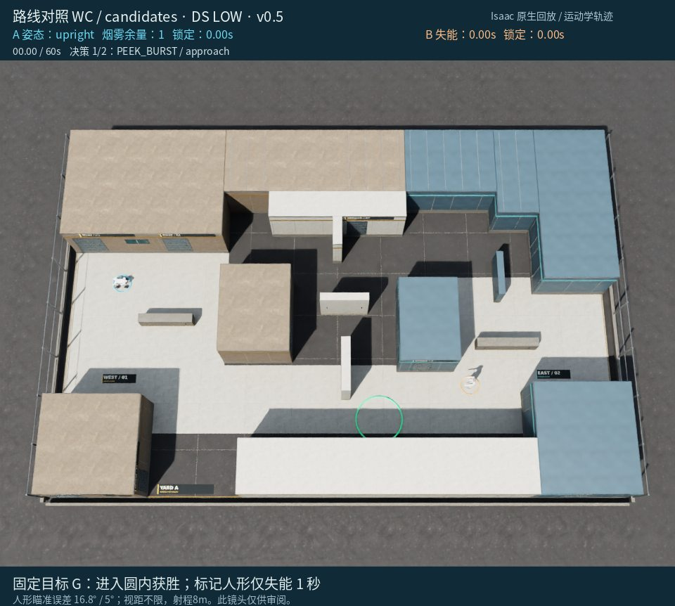
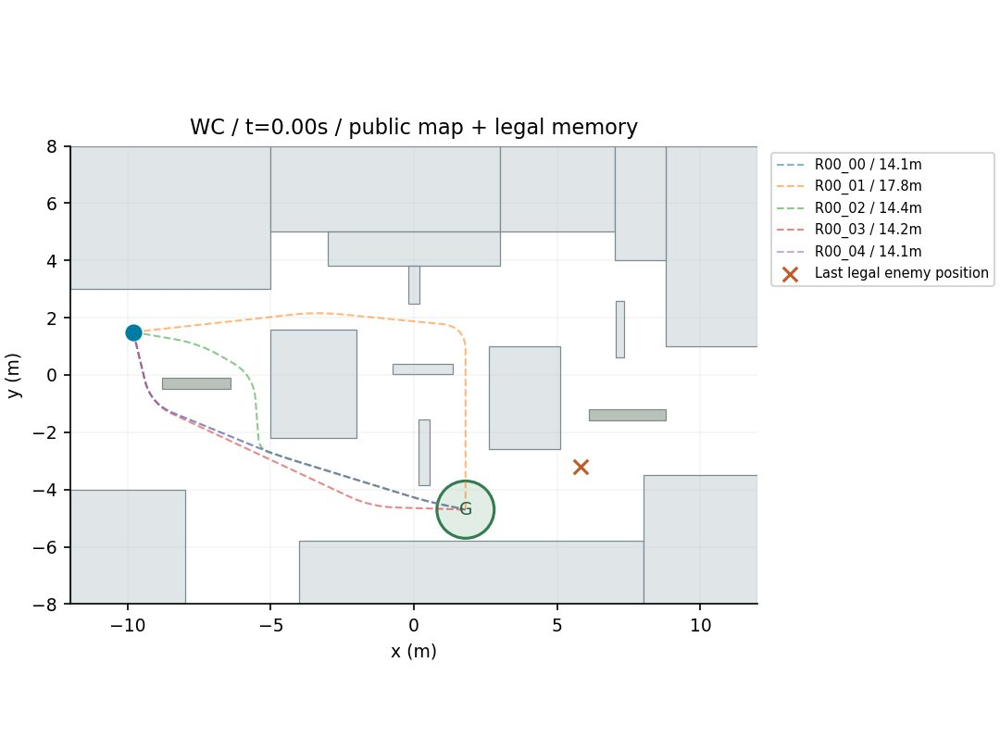
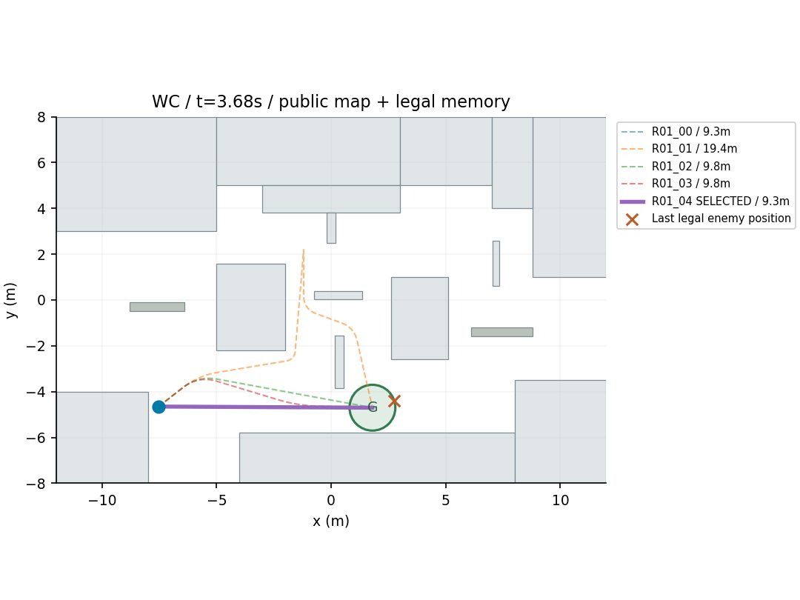
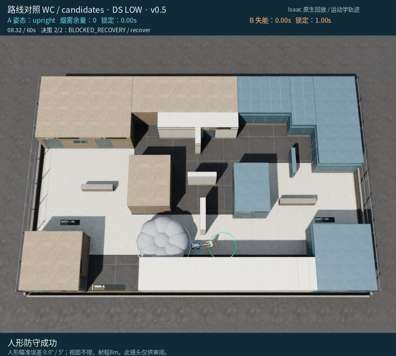

# 对局 6：候选组：烟冲仍选直达，暴露了局部绕避缺口

[返回成果目录](../README.md) · [完整 MP4](replay.mp4) · [离线交互页面](../index.html#run-6)

8.32秒被标记，仅2次决策。3.68秒在看到人形向西南移动后，选9.33米投烟直达；静态预计连续暴露1.08秒、最近敌距0.98米。7.08秒重新接敌，7.62秒累计8次碰撞停步后启动后退，8.32秒被标记。

> 下文简要依据是模型最终输出的原文，不是完整内部思维链。图片是事后全场审阅镜头，模型当时只收到合法几何观测。

**事后核对：**FOLLOW_CANDIDATE没有继承原单目标技能的观测驱动局部绕避，精确路线跟随直到碰撞后才后退。这是新执行器的实现缺口；候选的静态风险也未覆盖人形沿路迎面接近。

[原始决策与合法观测](decisions.json) · [原始返回、时长/token](call_records.json) · [完整系统提示词](system_prompt.txt) · [实际配置](trial_config.json)

## 决策 1 · 仿真 0.00–3.68 s

API 外部耗时 7.90 s；6,837 tokens（含推理）。



**观测依据：** 仿真0秒无当前检测，仅有初始敌位(5.8,-3.2)与初始自身位。

**自身状态：** 自身在SPAWN，直立、静止、冷却0、烟1；PK000接近暴露估计0m。

**选择与简要理由：** 当前敌情未知，先到EntryRoom东侧掩体PK000低成本探身获取信息，完成即重评。

**不确定性：** 旧敌位非当前真值；接近与探身仍可能被移动中的人形发现。

```json
{
  "observation_id": 0,
  "skill": "PLAN",
  "params": {
    "horizon_seconds": 6,
    "steps": [
      {
        "skill": "PEEK_BURST",
        "params": {
          "candidate_id": "PK000",
          "max_cycles": 1
        },
        "on_contact": "retreat"
      }
    ]
  }
}
```

实际执行：移动 6.68 m，距目标 13.15 → 9.33 m。完整事件见 [steps.json](steps.json)。



路线卡只使用合法敌情和静态风险估计；加粗为选中路线。模型未收到此图。

## 决策 2 · 仿真 3.68–8.32 s

API 外部耗时 17.69 s；9,261 tokens（含推理）。


**观测依据：** 当前合法检测人形于(2.74,-4.41)，朝向西偏南约181°，距我约10.3m，超出8m射程；运动估计向西南约(-0.91,-0.36)m/s。

**自身状态：** 我在(-7.53,-4.65)，直立，速度0，烟剩余1，标记冷却0，剩余56.32s；R01_04预测烟0.78s生效并持续至5.78s。

**选择与简要理由：** 选R01_04先向(-2.53,-4.53)投烟再直立直冲GOAL，不主动停下开火，遇8m内敌情不撤，争取在烟有效期与1s瞄准窗口内入圈。

**不确定性：** 人形继续西南移动可能缩短距离或进入烟区；静态风险估计不保证安全，出烟后最后约2m仍可能暴露。

```json
{
  "observation_id": 1,
  "skill": "PLAN",
  "params": {
    "horizon_seconds": 6,
    "steps": [
      {
        "skill": "FOLLOW_CANDIDATE",
        "params": {
          "route_id": "R01_04",
          "posture": "upright",
          "fire": "off"
        },
        "on_contact": "continue"
      }
    ]
  }
}
```

实际执行：移动 8.27 m，距目标 9.33 → 1.98 m。完整事件见 [steps.json](steps.json)。



路线卡只使用合法敌情和静态风险估计；加粗为选中路线。模型未收到此图。

## 终局



这份记录保留模型原始判断及其错误；赛后分析没有改写已执行动作。
