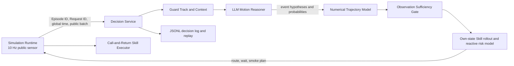
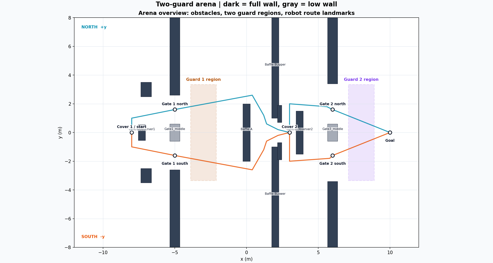

# LLM 守卫运动推理、显式优化与 Option 执行：第一阶段实现

最新审查（2026-11-18）：完整 8 组中 LLM 3/8、纯数值 4/8，尚未显示模型额外收益；72 次零 API 控制执行完整复现三场 LLM 胜利，而额外 16 组数值探查显示增加观察并非普适改进。本版不通过有效决策手段验收，不据此否定所有 LLM 架构。详见[完整配对与机制审查](LLM_COMPARISON_REVIEW_20261118_093403.md)。新增可选 `minimum_peeks_by_stage` 仅支持分阶段观察控制，默认策略未改变。

日期：2026-11-17。该实现针对现有双守卫 CPU 正式 Skill 实验环境。仿真进程与决策 HTTP 服务分开运行；决策服务调用 DeepSeek 或 Qwen API。Codex 不在运行时决策通路中。

## 工程核对与复用边界

| 现有机制 | 调用链与复用方式 |
| --- | --- |
| Episode | `llm_run_episode.py` → `option_env.run_episode` → `online_env.run_episode` → `OnlineProbe`。当前正式候选是两 actor 裁判：第二守卫从全局 `t=0` 独立影子巡逻，第二掩体交接。它不是三实体同屏裁判。 |
| 地图 | `two_node_geometry.add_two_node_geometry` 修改正式地图障碍；`trial_motion.Planner` 验证路径净空。`llm_semantic.build_map` 只生成空间 Node/Edge/Region，不读取某局巡逻路点。 |
| 视觉 | `VisualHistoryEncoder.encode` 在 10 Hz 采样合法目视位置；不向策略提供裁判内部 yaw 或 memory。`LLMOptionPolicy.observe` 只把该结构化测量、机器人自身状态和时间送进服务。 |
| 守卫 | `varied_patrol.sample/place` 每局生成四个随机私有路点、顺序、初始段、速度与停留；`PublicController` 与 `SouthDwellGuard` 按观测、反应计时切换巡逻、停留、AIM。公开规则整理于 `llm_guard_rules.json`。 |
| Skill/Option | `OptionController.decide` 每 50 Hz 推进底层 Skill，只在 Option 返回或中断后的 10 Hz 边界调用高层；LLM 不直接给速度。计划等待可跨多个完整 WAIT Option；异常先走安全回掩体或明确失败。 |
| 正式判定 | `CentralProbe` 及其底层 `Probe` 执行真实 Skill 导航、3D 遮挡、守卫反应、瞄准、`valid_lock`、`TagClock` 和烟雾规则。优化器仅以 LLM 假设创建的守卫路径替换私有巡逻生成器，没有读取测试局的私有参数。 |
| API | 复用已有 `scripts/deepseek_client.py` 与 `scripts/qwen_client.py` 的受限 HTTPS、无重定向、无自动重试接口；新 `APIReasoner` 把提供者接口统一。当前 DeepSeek 适配器固定 `deepseek-flash` 配置，切换服务商使用独立 Qwen 配置。 |

旧显式规划的训练巡逻库包含私有参数，**新系统的在线查询和轨迹生成不读取该库**。`llm_formal_optimizer` 的每个反事实守卫完全由当前合法观测估计与 LLM 假设生成。实验 seed 只交给仿真进程，服务请求没有 seed、真实路点、隐藏状态或未来轨迹。服务对意外的这些字段执行严格拒绝。

## 架构与协议



服务端 `POST /decide` 接受且只接受 `episode_id`、`request_id`、全局 `time`、`stage`、`decision_type`、`public`、`observations` 和 `skill_state`。公开测量含全局时间、守卫二维位置、观察者位置与方向、测量不确定性和帧有效标志。重复 `request_id` 返回原响应，不再调用模型或重复计划；API 错误也缓存为该请求的明确错误。`GET /health` 返回地图和代码版本；`POST /finish` 只在终局后传回结果，不能回流在线决策。

LLM 收到当前守卫区域空间图、公开规则、最近 30 条原始测量、旧观测计数、速度估计、同 Track 的先前假设与偏差。服务本地保存完整原始请求，不依赖 API 对话记忆。Prompt 版本和摘要、地图 ID、规则版本、模型响应 ID、token 用量、API/轨迹/优化耗时均写入 JSONL。

模型当前返回 `guard-motion-paths-v2` JSON：每个假设有数值概率、状态、合法有向 `edge_ids`、路径上的 `dwell_node_ids`、速度和停留范围，以及简短依据。下一目标与 MOVE 事件由路径确定性展开，避免同一路径重复输出两次导致冲突。内部仍用 `guard-motion-hypotheses-v1`，旧日志保持原始校验行为。可用 `UNKNOWN` 保留未覆盖概率。服务拒绝不存在的地图 ID、断开的 Edge、跨区域路径、路径外的停留点、不合法概率或超出公开能力的参数。LLM 不能输出底层控制。

当前 `trajectory_mode=observed_anchor_v2` 从最近合法测量位置直接接入假设路径的后续段，结合观测速度选择方向，不要求先走回空间图的起始节点。`velocity_mode=recent_acceleration_v2` 在精确、连续的测量上使用最近三帧和有界加速度估计当前速度，避免长窗口平均在刹车时滞后；测量不确定度超过 5 毫米或时间间隔不规则时保留平滑回归。状态、路径和剩余停留时间以 `latest_measurement_at` 为原点，先按 50 Hz 推进测量到请求的盲区，再输出请求时刻起的未来状态。停留可以在当前测量位置开始；记录 `source_observed_at`、`generated_at` 和测量年龄。0/1/3 秒推进与同一条连续预测的对应时刻须一致。API 当前暂停游戏时钟，墙钟耗时单独记录，不能重复加到游戏时间中。路径结束后标为未覆盖，不假定守卫停住。预测时域由机器人完整候选路线的最长执行时间加余量确定。

主动观察门检查采样数、测量年龄、UNKNOWN 概率、候选动作分歧和评分间隔。当前配置 `observation_gate_mode=action_risk` 保留熵的诊断记录，但不再仅凭假设熵较高就要求再次探头：多个不同预测可能支持同一动作。每节点探头次数与观察时长有上限。若观察仍不足，服务明确失败，不在无依据的轨迹上继续执行。门的阈值目前是工程初值，尚未用独立数据校准。旧日志没有此配置时使用原熵阈值，以保留回放行为。

正式评分 `llm_formal_optimizer.optimize` 枚举南/北、等待 0/1/2 秒、有无烟雾（资源合法时）。每条权重轨迹转化为一个**假设守卫**，从当前观测估计状态开始，用正式 `CentralProbe`、正式 Skill 路径、守卫 AIM/发现/蓄时和烟雾机制运行局部反事实。假设守卫分支关闭探针内部的守卫目视烟雾定位，与在线执行器的烟雾落点规则一致。此模式保留给离线审核；一次 4 条轨迹的本地评分实测约 141 秒，无法用于在线决策。

当前 Ubuntu 配置使用 `robot_rollout_mode=stateful_v2`。`llm_robot_rollout.py` 从当前公开位置、身体朝向和有符号速度开始，复用实际 Skill 的路径规划、圆角路径、速度积分、施放烟雾代码，按 50 Hz 预测到第二掩体或终点圈。共享静态地图与路径缓存，跳过整局裁判创建、另一实体、全量日志等计算；路径上的每条线段已用同一规划器验证，显式刹车离开路径时另外检查净空。守卫风险按 10 Hz 推进反应、停止、转向、瞄准和连续标记，复用 `HypothesisGuardController`、运动模型、`valid_lock`、`TagClock` 和烟雾遮挡。未观测朝向以全向发现包络处理。输出标注 `aligned_skill_reactive_v2` 和未校准的风险解释；其动力学离散率、碰撞与观测后动态绕行仍是近似，风险不能当作正式失败概率。原 `fast_los_proxy_v1` 和局部正式评分保留作历史回放，不覆盖当前完整转移过程；最终验证使用真实双阶段执行器。

服务启动时可从公开起点模拟名义开局探头，预计算三种返回状态的完整候选，实测一次约 3.3 秒，发生在游戏时钟开始之前。缓存键包含精确的传感器舍入后位置、朝向、有符号速度、烟雾资源和阶段；状态不符时重新计算，缓存命中也使用相同的状态化完整预测。`/health` 和运行清单记录启动预计算耗时。过门重评估还利用新鲜、连续合法目视约束“守卫可能已完成反应”的状态，身体朝向采用可能已朝向机器人的不利假设；没有读取裁判私有朝向、记忆、反应或标记计时。

`boundary_recheck=true` 使过门后的 Option 边界把新目视送回本地服务，比较继续、短等和回掩体，直接返回下一 Option，不必调用 LLM。每阶段最多两次边界等待和一次撤回。撤回抵达掩体后清理过门状态、重置观察窗口，旧路线不继续执行。底层 Skill 仍持续运行至 Option 返回或原有中断。默认 `max_llm_calls_per_stage=1`、`max_peeks_per_stage=2`；观察上限针对一个观察窗口，撤回后最多另开一次窗口，因此每阶段最多四次探头，LLM 预算不随撤回重置。LLM 调用预算用完后，新观察采用可见运动速度/方向的本地包络更新。局部数值权重和未知质量是工程设定，需用独立种子校准。静止且歧义大的数值观测优先再探头，避免先计算整组候选。

新配置另启用 `boundary_track_recovery=true`：过门边界记录超过轨迹模型的 4 秒年龄上限或缺少合法 Track 时，优先使用剩余一次撤回重新观察；恢复耗尽或观察上限后仍过期时明确拒答并计策略失败，不以旧记录冒充新测量。旧日志没有此开关时保留原行为，以便重放原错误。首次 8 组配对批次实际在第 2 组因该缺口中断，修复和续跑说明见[配对实验回传审查](LLM_COMPARISON_REVIEW_20261118_082817.md)。`llm_compare_ubuntu.py --reuse-responses-from 原配对包路径` 可对完整提示词/API 配置完全相同的请求复用已有输出，日志区分复用与新 API 响应；各回合重新仿真，不混算新旧策略结果。

新配置 `invalid_hypothesis_mode=unknown_mass` 将单条无效运动假设的概率移入 UNKNOWN，保留其余合法路线和原始输出，不补路线或只对合法部分归一化；整体输出不可用则计 `ModelOutputError` 方法失败并继续批次。公开协议或程序错误仍中止。2026-11-18 09:03 的回传在第 3 组遇到概率 0.13 的断接路径，修复后本地复用原响应能跑完前三局，但 LLM 仍 0/3 获胜，尚无额外收益证据。失败响应的 API 耗时现也计入汇总。详见[最新回传审查与补齐命令](LLM_COMPARISON_REVIEW_20261118_090327.md)。

快速评分单独使用 `maximum_fast_particles=18`，容纳当前最多 6 个假设各自的 3 个速度/停留样本。原先共用正式评分的 4 粒子上限，会把已知假设中被截掉的质量也计作失败，人为抬高风险。正式历史局部评分仍使用 `maximum_formal_particles=4`。

跨节点 `EpisodeContext` 根据合法测量的空间区域、时间及最大速度进行 Track 关联，分配独立 `track-xxxx` ID；身份不唯一或运动不相容时保留不确定性，不使用仿真实体 ID。历史预测仅与**同一 Track 的全局时间**后续合法测量比较。评估保存位置误差、运动方向误差、80% 场景带覆盖、最近轨迹事件代理类别、Brier/Log Loss 代理指标和可靠性分箱；路线事件代理不等于真实私有巡逻目标。终局后另记录所选动作的预测风险与实际阶段结果。

## 地图语义审核

[地图清单](llm_map_manifest.json)包含 31 个 Node、124 条有向空间 Edge、两个开放巡逻 Region 及 15 个障碍。守卫路点可在开放区域连续采样，**这些 Node/Edge 只是可通行几何，不是预定义的完整巡逻路线**。生成时所有点和 Edge 用正式 `Planner` 检查；语义入口/出口目前标记为 `geometry_verified_manual_semantics_pending`。人工审核无需阅读整份 JSON：先看[场地总览图](llm_map_review.png)，需要核对空间 Node/Edge 时再看[守卫区域拓扑图](llm_map_review_topology.png)。两张图直接从当前清单生成，分别展示墙高、南北路线、掩体、两块守卫活动区，以及每块活动区的 12 个空间节点；图中的轨迹线不是守卫的实际巡逻路线。



人工主要核对：起点掩体约 `(-8,0)`、第二掩体约 `(3,0)`、终点约 `(10,0)`；两处南北缺口分别在 `x=-5` 与 `x=6`；浅色守卫区域分别在 `x≈-3` 与 `x≈8`；深色是高墙，灰色是低墙。`llm_map_review.py --render-dir` 会重画最新图，并生成 `map_review_checklist.md`；批准命令会记录 reviewer、时间和状态。若图与期望场景不符，先反馈，不要批准。**几何一致性检查始终严格执行**；语义仍待人工确认时，真实 API 服务可以运行，但 `/health`、决策日志和压缩包中的运行记录都会标明 `geometry_verified_manual_semantics_pending`，结果只能作暂定工程观察，不能据此认定策略有效。

## Ubuntu 配置与运行

代码中**没有填 API key 的字符串常量**。首选在 Ubuntu 终端设置环境变量：

```bash
export DEEPSEEK_API_KEY='你的 DeepSeek API Key'
# 若改用千问：export QWEN_API_KEY='你的千问 API Key'
```

环境变量名和模型参数的具体位置分别是 [DeepSeek 配置](config/llm_decision_deepseek.json) 的 `api_key_env` 与 [Qwen 配置](config/llm_decision_qwen.json) 的 `api_key_env`。也可在相应配置加入 `api_key_file`，指向**仓库外**权限为 `0600` 的私密文件。不要把 key 写入仓库、运行日志或发给 Codex。DeepSeek 默认改成 `deepseek-flash` 非思考模式、最多 3072 输出 token、10 秒网络/墙钟预算和在线快速评分；这只是延迟实验配置，真实 API 响应时间与预测质量尚待 Ubuntu 测量。Qwen 配置采用 `qwen3.6-27b` 的非思考模式，因为阿里云[结构化输出文档](https://help.aliyun.com/en/model-studio/qwen-structured-output)将 Qwen3.6 开源系列的 JSON Object 支持限定在该模式。

同步代码后可以直接运行第一局；地图未批准时服务会给出暂定状态警告，不会再因这项审核而退出。想核对图时，执行下面命令。脚本会先自动核对清单与正式几何是否一致：

```bash
python3 benchmarks/two_guard_design_v1/llm_map_review.py --render-dir map_review
xdg-open map_review/map_review.png
```

若你能确认关键布局正确，再看完 `map_review/map_review_checklist.md` 并执行可选的正式语义批准：

```bash
python3 benchmarks/two_guard_design_v1/llm_map_review.py --approve --reviewer '审核者姓名'
```

推荐使用**一条命令运行并自动打包**。脚本启动独立决策服务进程，运行一局，停止服务，用保存的响应做离线回放，最后打印 `upload_this` 指向的 `.tar.gz`。成功和服务/回合失败时都会尽量打包；失败包内的 `run_manifest.json`、`service_stdout.log` 和 `episode_stdout.log` 供诊断。只需回传这个压缩包：

```bash
python3 benchmarks/two_guard_design_v1/llm_run_ubuntu.py \
  --first-seed 810000 --second-seed 820000
```

该命令默认使用 [DeepSeek 配置](config/llm_decision_deepseek.json)。千问运行时加 `--config benchmarks/two_guard_design_v1/config/llm_decision_qwen.json` 并设置 `QWEN_API_KEY`。可通过 `--output-dir`、`--bundle-path` 和 `--port` 自定路径与端口；默认创建唯一运行目录及同级压缩包，避免不同实验混写。HTTP 等待时仿真逻辑时间暂停，API 墙钟延迟单独记录。包内含决策 JSONL、LLM 原始请求/响应、回合 JSON、服务与仿真标准输出、回放与结果、地图/规则快照、去掉密钥字段的有效配置、运行元数据及每个文件的 SHA-256 清单。打包器会检查当前环境变量或 `api_key_file` 的密钥值是否误入这些文件，检测到则拒绝生成包。收到压缩包后可不解压直接校验：

```bash
python3 benchmarks/two_guard_design_v1/llm_bundle.py --verify /path/to/returned.tar.gz
```

无需 API key 的数值对照采用相同执行器、评分器和观察上限，仅将 `max_llm_calls_per_stage` 设为 0：

```bash
python3 benchmarks/two_guard_design_v1/llm_run_ubuntu.py \
  --config benchmarks/two_guard_design_v1/config/llm_decision_numeric.json \
  --first-seed 810000 --second-seed 820000
```

该配置的 provider 字段供兼容配置校验，实际不调用模型；运行清单标记 `decision_mode=numeric_only`。清单另记录 `llm_inference_attempts`（准备并进入推理接口的尝试，不等同于外部请求已发送）、`llm_responses_received` 和本地边界决策次数。包中新增机器人实际 10 Hz 自身轨迹、所选候选的预测轨迹及逐次守卫预测比较，便于核对评分和执行。每次运行仍自动输出一个压缩包。

本地不调用 API 的第一阶段逐项对照可复用回传输出：

```bash
python3 benchmarks/two_guard_design_v1/llm_audit_alignment.py \
  --archive ubuntu_logs/ubuntu-20261118-015825-070566.tar.gz \
  --archive ubuntu_logs/ubuntu-20261118-014710-6308ce.tar.gz \
  --output-dir .arena-workspace/experiments/llm-motion/alignment-audit
```

可加 `--cases baseline bounded_feedback numerical_only boundary_rescue` 缩小对照范围。报告明确区分正常终局、通过第一阶段、缺少新模型输出和运行错误，保存实际代码 SHA-256。旧输出是在旧提示词与时域下生成，因而该实验验证数值和执行改造，不代表新版真实 LLM 响应质量；强制旧错误动作的撤回实验另记录干预。

该配置只在回环地址收发，不要求 Codex CLI。独立评估可重复运行该命令，使用预先固定、互不重叠的种子序列；本阶段尚未开展真实 API 大样本评估。

需要分别调试两个进程时，仍可在终端 A 手动运行 `llm_decision_service.py --config ... --log-dir ... --port 8765`，终端 B 运行 `llm_run_episode.py --service-url http://127.0.0.1:8765 --first-seed ... --second-seed ... --output-dir ...`。手动运行完可调用 `llm_bundle.py --run-dir 运行目录 --output 压缩包路径 --config 配置文件` 打包；推荐的一键命令会自动做完这些步骤。

不调用 API 的离线重放读取日志里的**原始公开请求、保存的 LLM 响应及当时的服务配置**，逐项核对动作和终局评估；加 `--live-model` 会使用命令行配置，在同一公开请求上重新调用当前模型，用于 Prompt/模型比较，会产生 API 调用：

```bash
python3 benchmarks/two_guard_design_v1/llm_replay.py \
  --input-log .arena-workspace/experiments/llm-motion/ubuntu-run/decision_events.jsonl \
  --config benchmarks/two_guard_design_v1/config/llm_decision_deepseek.json \
  --output .arena-workspace/experiments/llm-motion/ubuntu-run/replay.json
```

## 本地验证状态与限制

- **已实现并通过测试**：地图与规则版本、可视化审核、待确认语义的暂定运行标记、严格运动 JSON 校验、公开 Track 关联、跨时间比较、数值多轨迹、正式局部裁判反事实、快速 LOS 代理、烟雾落点一致性、主动观察、Episode 隔离与幂等、HTTP 服务、Option 接入、JSONL 日志、记录响应重放、单包归档及 SHA-256 校验。可用 `python3 -m unittest discover -s benchmarks/two_guard_design_v1 -p 'test_llm*.py' -q` 运行针对性测试。
- **已运行工程端到端，但不代表真实 LLM 效果**：`--fixture-for-tests` 下，仿真与独立服务经本机 HTTP 完成两局，种子 `690000/700000` 与 `690017/700019` 分别在 `9.02 s`、`6.28 s` 被守卫标记；fixture 仅返回显式标记的假设，不是实际 DeepSeek 推理。记录在 `.arena-workspace/experiments/llm-motion/fixture-final/`，四次决策的记录响应重放 **4/4 一致**。另一次观察达到上限且旧目视过期的运行明确失败，未暗用隐藏状态。
- **已实现但尚未充分验证**：跨节点重新看到同一守卫的 Track 机制只有合成观测测试；当前几何阶段交接后通常看到的是另一守卫。概率校准、数值/正式反事实一致性、烟雾预算收益和观察阈值需要真实 API 与独立种子验证。
- **真实 API 现状**：`ubuntu-20261118-073656-9a7a8d` 的设计样例在 t=29.96 获胜，但简单固定策略也能更快获胜。最新 `comparison-20261118-082817-aae898` 的 8 组计划在第 2 组因过期目视处理缺口中断：第 1 组 LLM 和数值均失败，第 2 组数值获胜而 LLM 异常退出，两次真实 API 为 3.564/2.977 秒。本地复用原输出修复异常后，第 2 组仍失败；尚未显示 LLM 的额外收益。详见[配对批次审查与修复](LLM_COMPARISON_REVIEW_20261118_082817.md)及[原设计样例审查](LLM_RETURN_REVIEW_20261118_073656.md)。Qwen 连通性、稳定的结构化输出、模型运动推理质量和跨种子胜率尚未充分验证。本地没有密钥，也不应将 fixture 胜负当作研究结果。
- **2026-11-18 适配器导入修复**：回传包 `ubuntu-20261118-013450-859c67` 在发送 API 请求前即因旧适配器拒绝非思考配置而失败，该包不能用于测量 API 延迟。仿真依赖预先把冻结快照的 `deepseek_client`/`qwen_client` 放入 `sys.modules`，原先调整 `sys.path` 无法替换这些缓存。当前决策服务以独立包名加载 `scripts/` 下的当前适配器及相对依赖；服务启动时预校验配置，`/health` 和启动日志记录实际适配器路径及 SHA-256。回归覆盖新进程中的服务导入顺序和非思考 API 适配器调用（模拟网络返回）。冻结快照保持原样。
- **2026-11-18 真实非思考调用结果**：`ubuntu-20261118-014710-6308ce` 使用正确适配器，两次 API 用时分别为 6.509/5.647 秒，首输出为 0.669/0.764 秒，输出 1242/1096 token，均无思考内容。第二次有 2176 个输入 token 命中缓存；大部分墙钟时间发生在首输出后。第一次因熵阈值再次探头，第二次因 REVERSE 与重复 MOVE 路径表达冲突而失败；没有通过路线或终局胜负。原日志 3/3 可完整重放。当前已改为精简路径协议、面向动作风险的观察门和完整快速粒子评分。将保存的两个模型输出确定性转换成精简路径表示进行离线诊断，第二次观测可规划北侧立即通过且不用烟，本地评分约 30 毫秒；这不是新的真实 API 输出，也不是该行动成功的证据。
- **2026-11-18 首次真实完整回合**：`ubuntu-20261118-015825-070566` 使用精简协议，一次 API 调用 3.264 秒、首输出 0.634 秒、输出 644 token；服务总耗时 3.995 秒，轨迹生成 0.024 秒、代理评分 0.028 秒。运行、2/2 次决策回放及 1/1 次终局评估重建均正常。机器人在 t=3.3 决定北侧立即行动且不用烟，t=6.5 过门，t=7.48 在向第二掩体移动期间被标记，未交接第二守卫。代理失败风险仅 0.08；南北立即行动的评分相同，按固定平局规则选北。后续 13 个合法目视的平均预测位置误差为 3.852 米，80% 预测带覆盖 0/13。这是策略失败，`completed` 只表示程序运行完成。
- **该回合的本地动作对照与机制诊断**：在相同 810000/820000 种子、相同开局南侧探头和同一 Option 执行器下，枚举第一阶段的 12 个固定动作，不调用 API。原动作稳定复现 t=7.48 失败；北侧等 1 秒、不用烟可在 t=11.02 交接，北侧立即用烟可在 t=11.32 交接。共 5/12 个候选通过第一阶段。第二阶段使用固定北侧动作，故这些对照不评价 LLM 第二阶段能力，亦不是跨种子胜率。记录保存在本地 `.arena-workspace/experiments/llm-motion/review-20261118-015825/fixed_action_counterfactuals.json`。主要缺口：守卫预测先绕回共享空间节点 (-3.9,3.2)，t=5.4 仍预测在北端而真实目视已在 (-2.72,0.08)；机器人模板忽略探头返回时朝向和残余速度，且只覆盖局部出口而非真实的第二掩体绕行；执行期间的新目视虽持续采集，过门边界仍直接推进旧计划，未用其修正风险。应先在本地修正并验证这些一致性问题，再继续真实 API 策略评估。
- **三项对齐修订的本地结果**：固定 810000/820000 并复用已保存模型输出，原版 t=7.48 失败；守卫对齐加状态化完整路线、两次观察、每阶段一次 LLM 输出和边界本地更新后，可在约 t=13.6 观察到进入第二阶段。原始失败轨迹前 4.1 秒的新机器人预测与实际位置差异小于 1e-4 米，旧模板在决策后 3 秒偏差约 1.34 米。相同 13 个后续目视的守卫误差从 3.852 米降至约 1.788 米，80% 预测带覆盖从 0/13 升至 10/13。均为同场景诊断，非独立种子效果证明。
- **简单策略与反馈收益的边界**：纯数值模式以及固定两次观察的纯数值模式也在同一样例约 t=13.6 进入第二阶段，故当前证据未证明 LLM 的额外收益。强制执行旧的北侧立即行动后，新边界检查可在 t=6.5 请求撤回并于 t=9.7 返回掩体重新观察，避免原来的 t=7.48 终止；之后仍在 t=17.16 失败，不能报告为获胜。正常修订轨迹中，过门检查选择继续，对这一样例没有单独的通过率增益。
- **端到端数值对照**：在移除 DeepSeek/Qwen 环境变量且不使用 fixture 的完整 HTTP 运行中，模型推理尝试和响应均为 0，t=13.52 完成交接，第二阶段也发生重评估与撤回，最终 t=45.2 被标记。12/12 次服务决策及终局评估重放通过，自动打包成功。回放采用 1e-12 浮点容差并报告是否逐位相等；动作、计数、布尔结果和结构保持严格比较，Brier 类别排序固定以消除集合遍历顺序差异。
- **当前计算折衷**：未命中的完整自状态候选首次约 1.5 秒；名义开局的预计算在启动时花约 3.3 秒，两个真实探头返回状态均精确命中缓存。最终无 API 数值回合中，第一阶段完整决策约 0.33 秒，第二阶段两次约 0.69/0.73 秒，三次边界更新约 0.27/0.12/0.07 秒，推理尝试和响应均为 0。最新 Ubuntu 真 LLM 回合预计算 4.331 秒，本地计划 0.434 秒、边界 0.376/0.151 秒，含 API 的服务请求共 4.609/5.674 秒。覆盖真实转移和初始运动状态的成本仍远小于原始约 141 秒的逐候选完整裁判。等待 API 时仿真仍暂停，连续运行的延迟补偿尚待验证；跨种子质量也需单独评估。
- **工程替代与范围**：本阶段复用 CPU 双 actor 交接裁判，未实现 Isaac Sim 原始图像输入或三实体同时裁判；在线优化使用状态化单机器人 Skill 预测和 10 Hz 守卫反应风险模型。朝向未知的处理、观测后动态绕行、碰撞和数值包络的概率校准仍有近似，尚未实现整局联合资源优化。地图语义尚待人工审核时，服务会保留待确认标记并允许暂定运行；几何不一致仍拒绝启动。
- **计算成本与延迟修订**：原始 Ubuntu 回传中，第一轮 DeepSeek 调用在约 `24.46 s` 后返回非法目标 ID；没有保存输出 token/首 token 时间，不能单凭它断定地图输入是主因。相同公开请求的本地 fixture 完整正式评分约 `141.3 s`，快速代理评分约 `0.007 s`、端到端服务决策约 `0.55 s`。因此默认在线模式改为非思考 API 与快速代理，正式评分只做离线审核。真实 API 总延迟、首输出时间、缓存命中、质量与实时性尚待新 Ubuntu 包验证。
- **快速评分核对**：原始回传观测的 fixture 假设下，快速代理与正式评分均选南侧、立即行动、不用烟；另两个合成守卫位置和速度案例在只评最高权重粒子时，最优动作也一致。三例是工程一致性检查，不是独立种子上的策略效果证明。快速模式的 fixture 完整 HTTP 回合与记录响应回放通过，运行压缩包按原流程生成。
- **终局预测评估回归**：`fixture-terminal-eval/fixture-terminal-001.json` 的末尾合法目视随 `/finish` 送达服务，同 Track 得到 6 个全局时间对齐的预测比较；修正概率分箱边界后，`fixture-terminal-eval/replay_corrected.json` 的 2 次决策完全一致、1 次终局评估重建成功，分箱计数总和为 6。该 fixture 的 80% 场景带覆盖为 0/6，清楚表明测试假设本身不能当作可用预测器。
- **最终修正后端到端回归**：`fixture_final_verified/fixture-verified-001.json` 经独立 HTTP 服务完成一局，在 `9.02 s` 被守卫标记；`fixture_final_verified/replay.json` 的 2/2 次服务决策与 1/1 份终局预测评估完全重现。服务当时的 `maximum_formal_particles=1` 从日志恢复；若误用正式配置的 4 条上限，动作虽相同，风险评分会改变，故回放必须使用实际服务配置。此 fixture 的 80% 场景带覆盖仍为 0/6，不能证明 LLM 预测质量。
- **自动归档回归**：`llm_run_ubuntu.py --fixture-for-tests --duration 1.5` 的短回合自动完成服务、回合、回放和压缩，生成 `bundle_smoke_20261117.tar.gz`，含 10 个运行文件及包内校验清单；服务因地图尚未人工批准而启动失败的回归也产生了 `bundle_failure_smoke_20261117.tar.gz`，记录明确失败原因。测试 fixture 不构成真实 API 效果评估。
