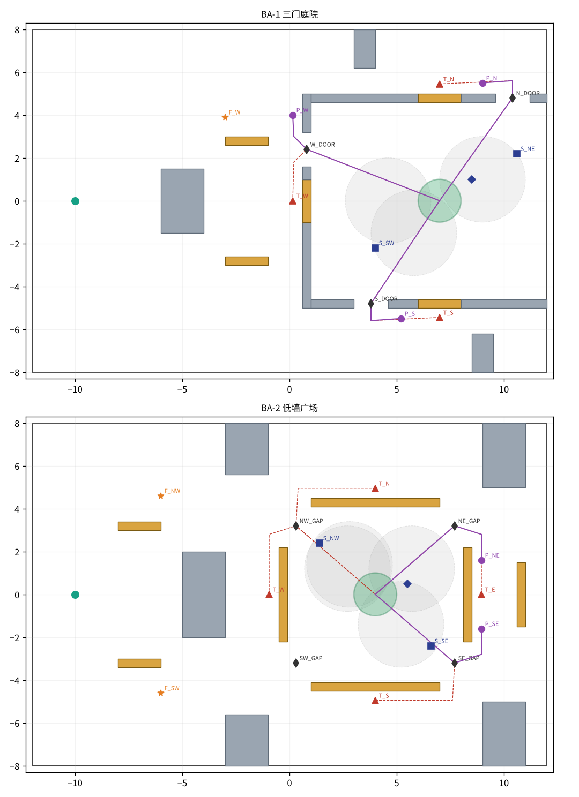

# 地图 BA-1 / BA-2

两张图都是 24 × 16 m，四足从西侧出生，目标在东半场，人从目标旁边开局。地图数据都在 `maps/BA-*.json`：

- `points`：命名点位，类型有门、投烟点、埋伏点、远守位、佯动点、通道点和掩体；
- `plays`：打法路线（投烟点到目标的冲点路线、接近路线、埋伏点的突袭路线、诱敌转移路线），以及烟落点提示；
- `cycle_checks`：打法对策矩阵；
- `human_bots`：人方机器人参数；
- `rule_planner`：只给规则基线用的偏好。

其中 `cycle_checks`、`human_bots` 和 `rule_planner` 都不会进入模型的提示词。

图例：

- 灰色是 2.4 m 高墙，橙色是 0.7 m 低墙；
- ▲ 是投烟点，红色虚线是它的冲点路线；
- ● 是埋伏点，紫色实线是它的突袭路线；
- ■ 是远守位，★ 是佯动点，◆ 是门；
- 灰色圆是该投烟点的“通吃”烟落点。

## BA-1 三门庭院（演示用）

东侧是一个 11 × 9.2 m 的围合大院，目标在 (7, 0)。院子有西、北、南三扇门，每扇门旁边有一段 0.7 m 的低墙窗：四足贴在窗后隐蔽，同时能越过窗投烟。

- **侦察和佯动**：F_W (−3, 3.9) 正好在“目标—西门”这条视线的延长线上，距目标 10.7 m，超出 8 m 射程。四足站在这里，能看清人是守在点上还是正往外走；人也会看到它，但打不到。
- **封烟强冲**：首选北窗投烟点 T_N。烟落在冲点路线上，例如 (8.6, 2.2)，可以同时挡住贴点和东北远守位。如果烟落在目标上，只能挡住贴点。
- **诱敌迂回**：在 F_W 露面后，沿北走廊转移到北门外的埋伏点 P_N（约 4.6 s，全程不会被看见），等人走出西门再从北门突袭。走南门要等人走得更远。

## BA-2 低墙广场（实验图）

目标外面只有一圈低墙，四个角敞开，再往外是高墙块。视线开阔，主要受 8 m 射程限制。

- 守点、远守都能被规则基线破解：它按观察到的人的位置计算烟落点，并避开有人盯着的投烟点。
- **已知短板**：固定的诱敌迂回打不过出击者。人在开阔广场里，不用走远就能看到四足绕到对侧。静态检查给出的“人走出 5 m 就能迂回”，前提是人会沿追击线一直走；机器人实际不会这样走，所以这个数字偏乐观。要让 BA-2 的迂回成立，需要增加遮挡，或者缩短绕行路线。

## 静态设计检查（`python -m breach_arena checks`）

这项检查不跑比赛，只用理想化运动（先加速再匀速，不减速）和一个静止观察者来估算：观察者连续看见 1.2 s，就算能完成锁定。快照存放在 `maps/checks/checks_BA-*.json`。

| 检查 | BA-1 | BA-2 |
| --- | --- | --- |
| 不放烟时，贴点守看见各条突袭路线的时间（越长越容易被锁定） | 1.84–2.18 s | 1.68–1.78 s |
| 目标烟能否挡住贴点 | 能（T_N、T_S；T_W 离目标 6.85 m，超出投掷距离） | 能（全部投烟点） |
| 目标烟挡不住哪个远守位 | S_NE 挡不住 T_N 的冲点（1.78 s）；S_SW 挡不住 T_S 的冲点（1.72 s） | S_NW 挡不住 T_W、T_N、T_E；S_SE 挡不住 T_S |
| 是否存在同时挡住所有守位的“通吃”烟落点 | 每个投烟点都有 | 每个投烟点都有 |
| 诱敌迂回：人至少走出多远，突袭才安全 | 北门 7 m，南门 9 m | 5 m（偏乐观，见上） |

“通吃”烟落点意味着：人只要原地不动，不管站在哪里都挡不住一颗放对位置的烟。烟的半径缩到 1.25 m，这个结论也不变。所以人真正的反制手段是动起来，或者盯住、抢占投烟点。这就是本作把对策设计成“守点 / 出击”两种打法循环的原因。

## 打法对策矩阵（`python -m breach_arena matrix`）

每张图都在 JSON 的 `cycle_checks` 里写明了预期胜方，测试会逐项比对。当前结果：BA-1 12/12，BA-2 8/8。逐项结果和说明见 [README](README.md#当前结果本提交确定性可用-matrix-复现)。改动地图或规则后，先跑一遍矩阵，再更新这里和 README 中的数字。
