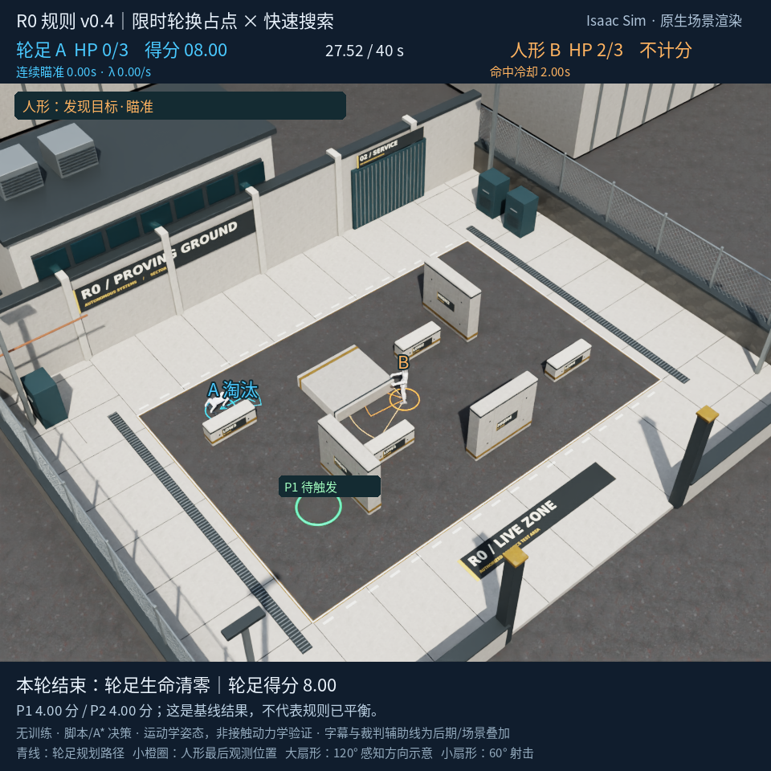

# 复现、验收和研究边界

## 发布范围

本仓库是 2026-10-22 对原工程制作的独立发布副本，不是对原机全部 workspace 的备份。保留场景/规则/策略/API 适配/渲染/报告源代码和 JSON，补充了可迁移路径、素材下载器、CPU 演示、环境检查及文档。

未修改裁判的命中公式、计分逻辑、运动学速度或 LLM 的研究策略。发布适配主要处理：本机硬编码目录、运行产物目录、缺失可选 Git 依赖的记录、凭据路径、大地图的归档规则依赖、首次 URDF 转换和离线准备目录。原机工程及历史实验结果不被覆盖。

## 已执行的本地验收

验证日期：2026-10-22。使用原机已有 Python / Isaac 安装，但**新发布目录、独立运行和素材缓存**；没有重新安装整个 NVIDIA 发行版，没有调用付费 LLM。

| 检查 | 结果 / 范围 |
| --- | --- |
| 原有 CPU 回归测试 | 192 项；无素材时 191 通过 + 1 项贴图检查跳过 |
| 加入可移植性测试后 | 201 项；准备素材后全部通过 |
| 素材离线恢复 | 4 个官方 ZIP，仅提取 12 张规定 JPG；全部 SHA-256 一致 |
| CPU 规则基线 | seed=20261021，1377 个 tick，27.52 s，8.00 分，A 被淘汰 |
| 规则参照文件 | SHA 与归档试验字节一致；不需要原机历史 run 路径 |
| Isaac 工业场地预览 | 原生 RTX PathTracing；21 帧；27.52 s 的完整比赛逻辑，预览影片不是实时完整回放 |
| 新缓存 Go2-W 转换 | 从固定 Unitree URDF 生成，未依赖原有转换缓存 |
| 离线 API 准备 | DeepSeek 与 Qwen prepare 均成功；0 个付费请求 |
| 机载预检 | 验收详情见随包 `release_validation.json` |

本发布版比赛预览：



baseline 原配置哈希：

```text
trial_config.json  969cb3ae63cfca526b40ed8e7fef5fee6154b256c37b309284c70ce9eedbce6d
timeline.json      9c3db219d9fb69d197d1b338a66bf91059ef69e18e351df8c497031d56fd3898
events.json        67b703f4fced85da1f5a5265bb3fd7ef43b9faa97c43abc554cbc2417a901839
validation.json    0fbc8d4eec2690bfba0f2a54b5a804e927644f0f3a8d74ac3de18e64d9729176
```

它们对应本发布版 `cpu_demo.py` 的 JSON 序列化和上述依赖组合。换硬件、浮点库或依赖版本可能影响最后几位浮点文本，因此应先比较规则配置、事件和关键指标，再分析文件哈希差异。API 模型输出和 RTX 像素不承诺位级复现。

## 验收不是哪些结论

- 没有在第二台全新机器完成 NVIDIA 全栈联网安装；安装文档提供固定依赖与已知兼容补丁，并要求复现者分层测试。
- 没有在打包时重跑完整 DeepSeek / Qwen 比赛；不能据此宣称当前供应商接口永远可用或成绩可精确重现。
- 没有验证真实四足关节控制、接触动力学、实体机安全或端侧实时延迟。
- 没有将 DOCK 07 大地图接入比赛；v1 有既有原生地图审阅与本包 CPU 几何测试，v2 只是开发快照。
- 原生渲染日志包含 Unitree USD 材质/空 visual 引用警告，当前视觉 actor 使用任务内材质重新绑定。程序通过与图片可见不等于所有导入警告被消除。

## 不同复现目标

1. **规则复现**：固定配置/seed/软件版本，检查裁判事件和得分。CPU 即可。
2. **图像复现**：安装素材、模型和 Isaac，重建 USD、相机和画面；重点比几何、视角、内容，不是每个像素的哈希。
3. **轨迹复现**：使用完成比赛的四个 JSON 重新渲染；不请求 LLM，保留原始成绩。
4. **策略实验复现**：再次运行模型，保留真实请求、实际返回模型标识、输出限制、seed 和失败记录；允许由于模型随机性 / 服务更新产生不同结果。
5. **论文级复现**：额外发布完整数据、实验协议、多种子重复、置信区间与消融；源码仓库本身不自动构成这些证据。

## 历史模型比较报告

保留 `scripts/research_*.py` 和 HTML 模板，但它们引用指定的历史 run ID。约数百 MB 的截图、视频、模型响应和原始日志没有放入 Git，因此克隆后不能直接重建原报告。

若后续发布数据集，应保留目录和文件哈希，并通过：

```bash
export ARENA_RESEARCH_RUNS=/absolute/path/to/released-runs
export ARENA_RESEARCH_OUTPUT=/absolute/path/to/new-report
```

指定独立数据位置。不同报告入口读取哪些 run，应先看 `research_data.py`，不要将缺失数据误记作零分或零 Token。网页自动化检查 `.mjs` 还依赖 Playwright，属于可选工具，不是 CPU 核心依赖。

## 建议的下一轮研究

统一规则、观察权限、提示词输入与 SKILL；对每个模型至少使用多个固定 seed / 重复样本。并列记录得分、存活时间、目标触发与完成次数、受击数、路径距离、危险暴露、无效 / 拒绝技能、API 时长分布、输入/输出 Token 和失败率。不要单凭一次最高分宣布模型更优。

从暂停式离线决策向端侧实时系统推进时，还需专门研究延迟、图像异步队列、动作执行期间的安全监督，以及过期决策拒绝；这些不在本版本的结论范围内。
